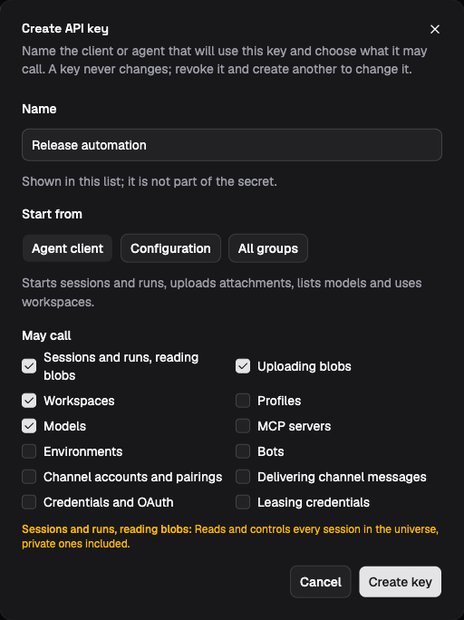

# API keys and service access

An API key gives a program access to the core gateway. Its authority has three
parts: the scope it reaches, the method groups it may call, and whether it may
name an actor. Core checks those facts on each request. It does not look up a
Platform user or apply that user's role.

This distinction matters when giving someone a key. A key with the `session`
group can read and control private sessions in its universe. It is an
integration credential, not a personal token constrained by the holder's
[Platform membership](people-and-roles.md).

## Gateway modes

Set `LIGHTSPEED_AUTH_MODE` explicitly; the gateway refuses to start without it.

| Mode | Behavior |
| --- | --- |
| `authenticated` | Each request requires `Authorization: Bearer lsk_…`. The gateway resolves an active key and checks scope, method group, and any actor assertion. |
| `single` | Unauthenticated local development access to the universe selected by `LIGHTSPEED_PG_UNIVERSE_ID`, plus deployment administration. Keep this listener private. |

Single mode rejects authorization, universe, actor, and the retired principal
headers. It cannot be combined with authenticated clients. The Platform uses
authenticated mode, including in the full development stack. The former
`trusted-header` and `api-key` modes are no longer supported.

In authenticated mode, scope determines how the request selects its target:

| Key and operation | `x-lightspeed-universe` |
| --- | --- |
| Universe key, universe operation | Omit it. Even the key's own universe is rejected as a header. |
| Deployment key, universe operation | Required; names the target universe by its UUID or its handle. |
| Deployment key, deployment operation | Omit it; the operation addresses the deployment. |

A handle is the universe's readable name, unique within the deployment. It is
resolved when the request arrives, so a renamed universe is no longer reached
by its previous handle, and a handle that names no universe is reported as not
found. The UUID never changes. Use the handle where the same automation runs
against several deployments, and the UUID where a rename must not redirect a
client.

`initialize` accepts either key scope before universe selection and requires
that the universe header be omitted. It reports key scope and groups without
listing universe resources.

A universe key cannot call deployment operations. A deployment key can reach
any universe, but only through its assigned method groups. Groups cover API
families such as `session`, `profiles`, `mcp`, and `environments`; they are not
Viewer, Contributor, Operator, or Admin roles. For example, `session` includes
session mutations as well as reads and blob reads. `blobs/put` is separate so
a connector can upload attachments without reading sessions. Exact groups are
listed in the [API reference](../../../crates/api/contract/api-reference.md).

Session deletion and retention changes require the separate `session/delete`
group; existing `session` keys do not gain those capabilities. Direct
`session/delete` calls permanently delete by default; `softDelete: true` retains
hidden history. Listing and purging already soft-deleted sessions require a
deployment key with `deployment/sessions`. Provision these groups on service
keys that need them. Platform always forces soft deletion for member requests
and reserves its audited purge route for Platform admins.

An actor assertion uses `x-lightspeed-actor`. Only keys created with
`assertActor` may send it. Core records the opaque actor ID for attribution;
asserting a user does not reduce the key to that person's permissions. The
Platform checks membership, role, and session visibility before asserting its
user's ID. Any other service allowed to assert actors must make its own
authorization decisions.

## Bootstrap without Platform

The first key of a deployment has no key to authenticate with, so it is made on
the server host. After migrations, run `lightspeed-runtime api-key provision`
there to generate a deployment key, or supply its secret through
`LIGHTSPEED_BOOTSTRAP_API_KEY` to declare one. The command prints JSON for
protected capture. The key uses the ordinary hash store and remains
revocable. The initial deployment key does not require an existing universe.

`provision` names the key with `--key-id` (default `bootstrap`) and limits it
with repeated `--group`; without groups it holds every deployment group. With
a supplied secret it is a declaration, described under
[Declare a key with a supplied secret](#declare-a-key-with-a-supplied-secret):
repeating it changes nothing, changed groups are applied, a different secret
replaces the previous one at once, and a revoked key is never restored.
`--require-existing` only checks that the supplied key exists exactly as
described, and creates or changes nothing.

Connect with `lightspeed connect add`, select with `connect use`, and create
universes through the CLI. Both development launcher profiles provide an
automatic `connect dev` handoff. See
[Use Lightspeed from the terminal](../using-lightspeed/cli.md) for the complete
standalone and Platform-compatible setup.

## Bootstrap the Platform

For local development, use [the root launcher](../development/local-development.md).
It provisions the authenticated stack. For a manually operated deployment,
first configure the stores and apply migrations as described in
[Self-hosting](../deployment/self-hosting.md), then mint the Platform's key
from the server host:

```bash
lightspeed-runtime api-key create \
  --deployment --assert-actor --name "Platform"
```

From a source checkout, replace `lightspeed-runtime` with
`cargo run -p temporal-runtime --` in these commands.

Omitting `--group` grants every group allowed by the scope. This is intentional
for the Platform, which manages universes and keys as well as member requests.
The command prints the secret once. Store it as
`LIGHTSPEED_PLATFORM_API_KEY` in the Platform's protected configuration and set
`LIGHTSPEED_API_URL` to the gateway's `/rpc` endpoint. Set the gateway to
`LIGHTSPEED_AUTH_MODE=authenticated`.

Before the Platform's first startup, also set
`LIGHTSPEED_PLATFORM_ADMIN_EMAIL` and `LIGHTSPEED_PLATFORM_ADMIN_PASSWORD` in
its protected configuration. When its users table is empty, Platform creates
that local administrator account. These settings do not reset an existing
account or grant a runtime key to the browser. Sign in with the new account,
then create a universe and add members as described in
[People and roles](people-and-roles.md).

If provisioning a universe directly through the server host, use
`lightspeed-runtime universe create --handle acorn` and retain its
printed UUID. Platform-created universes are provisioned through its deployment
key. See [People and roles](people-and-roles.md) for account administration.

<a id="create-and-revoke-keys"></a>

## Create, rotate and revoke keys

Universe Admins can open their universe's **API keys** page, choose **Create
key**, supply a name, and choose the method groups the key may call. The form
starts from the **Agent client** preset (sessions, blob uploads, models and
workspaces) and also offers **Configuration** and **All groups**; any box can
be ticked or cleared. Credential leasing and channel delivery are never
included unless chosen, and the form warns when they are, as it does for
sessions, which reach private sessions too. Keys minted here never assert
actors. The list shows what each key may call. Copy the displayed secret into
the client's protected credential configuration before closing the dialog; it
cannot be recovered.



*The demo form shows the Agent client preset before key creation. Review the
selected groups and their warnings before choosing Create key.*

Platform administrators can instead use **Platform admin → API keys** to
select a universe or deployment scope, method groups, and actor assertion.
The host CLI provides the same controls. For example, to restrict a key to
profile operations in an existing universe:

```bash
lightspeed-runtime api-key create \
  --universe-id "<universe-uuid>" --name "Profile automation" --group profiles
```

Repeat `--group` for additional groups. This key can modify profiles; the group
does not mean read-only access. Verify it with a profile read through the
[API client](../integrating-and-extending/api-and-typescript.md), then confirm
an operation outside that group is refused.

Every key has a key id: its name among the keys of its scope, which is one
universe or the deployment. The id addresses the key and stays the same when
its secret changes. You may choose it when creating a key (`--id` with
`lightspeed`, `--key-id` with `lightspeed-runtime`);
otherwise the runtime allocates one. Two universes can each have a key with
the same id. Listings also show the display prefix, the first characters of
the key's current secret, which tells you which secret a key holds and changes
with it.

Core stores a SHA-256 hash of the random secret, the display prefix, and key
metadata. Choose **Rotate** on an active key to replace its secret immediately.
The new secret is shown once and the old secret stops working for subsequent
requests, with no grace period. Update every client using that key. Rotation
changes the display prefix and clears last use, while preserving the key id,
name, scope, groups, actor flag, creator and creation time. Revoked keys
cannot be rotated. The Platform records the key id and the new prefix in its
access audit. Keys that assert actors must be rotated from **Platform admin →
API keys**.

Both CLIs rotate a key by its id and scope:

```bash
lightspeed --universe "<universe>" api-key rotate "<key-id>"
lightspeed api-key rotate "<key-id>" --deployment
lightspeed-runtime api-key rotate "<key-id>" --universe-id "<universe-uuid>"
```

The first two commands use the configured connection. Without `--deployment`
the key belongs to the selected universe: `--universe` with a UUID or handle,
or the saved selection. The third accesses the
store from the server host, where omitting `--universe-id` addresses a
deployment key. Each returns the new secret once. If you rotate the
credential used by your CLI connection or Platform service, update that
configuration before making further requests.

A key's scope and actor flag cannot be changed. To change either, create a
replacement, update and verify its consumer, then revoke the old key in the
UI or by id. Its groups can be changed by declaring the key, as described
below. A revoked key keeps its key id, so a replacement needs a new one.

```bash
lightspeed-runtime api-key list
lightspeed-runtime api-key revoke "<key-id>" --universe-id "<universe-uuid>"
```

## Declare a key with a supplied secret

Creating a key has the runtime generate the secret and show it once, which
suits a person at a terminal or in the web app. Automation usually needs the
opposite: the secret already exists in a secret store, and both Lightspeed
and the service that will use the key should read it from there. For that,
declare the key and supply its secret:

```bash
lightspeed api-key generate-secret > platform.key   # or let your secret store generate it
lightspeed api-key put platform --display-name "Platform" --deployment \
  --assert-actor --secret-file platform.key
```

`lightspeed api-key generate-secret` works offline and prints a secret in the form the
runtime accepts: `lsk_` followed by 32 random bytes encoded as base64url
without padding. Any cryptographic random source that produces that form will
do, for example `printf 'lsk_%s' "$(openssl rand 32 | basenc --base64url | tr -d '=')"`.
The secret is read from `--secret-file`, `--secret-env`, or `--secret-stdin`,
never from the command line.

After `put`, the key of that id and scope exists, answers to exactly the
supplied secret, and holds the given groups and name:

| Situation | Result |
| --- | --- |
| The key does not exist | It is created with the supplied secret. |
| It exists with the same secret | Its groups and name are updated if they differ. Otherwise nothing changes. |
| It exists with a different secret | The supplied secret replaces it at once. The previous secret stops working with no overlap, so update or restart every consumer. |
| The declaration changes the actor flag | Conflict. Declare a new key. |
| The key was revoked | Conflict. A revoked key is never restored; use a new key id and a new secret. |
| The secret belongs to another key | Conflict. A secret identifies one key. |

Repeating the same declaration is therefore safe, which is what a deployment
pipeline needs. A key that was created earlier with a generated secret and an
allocated id can be brought under declaration: supplying that key's secret
under a chosen id gives the key that id.

The same call is available as `deployment/api-keys/put`, and the server host's
`api-key provision` applies it without needing a key, for the first key of a
deployment. Environment registration keys can be declared the same way; see
[Registered daemons](../environments/registered-daemons.md#declare-the-key-from-a-secret-store).

Rotation and revocation reject subsequent requests using the old secret.
Already admitted requests, including
parked long-poll reads, are not reauthenticated while waiting. Revocation does
not cancel admitted work or recall credentials delivered to another process.

## Connect services

Give each service the groups its API calls require:

| Service | Key and behavior |
| --- | --- |
| Platform | Deployment key with all groups and actor assertion; the Platform gates member requests. |
| Shipped channel connector host | Deployment key with `deployment/channels`, `channels/inbound`, `auth/lease`, and `blobs/put`; account requests select their universe. |
| Configurator MCP client | Supplies its own key per request; Configurator forwards its authority to core. A browser login is not a credential for this path. |
| Platform's Configurator setup | Creates a universe key with `profiles`, `mcp`, `environments`, `bots`, `channels`, `auth`, and `models`, without actor assertion. It excludes `session`, so the key cannot call session methods. |

The Platform stores the Configurator setup key in an outbound credential grant
for the MCP connection. That credential lets an attached agent configure shared
resources; the requesting person's role does not travel through the MCP call. Follow
[Configurator MCP](../integrating-and-extending/configurator-mcp.md) or
[Channel connectors](../integrating-and-extending/channel-connectors.md) for
connection procedures, and [Agent and tool access](agent-and-tool-access.md)
for the execution boundary.
