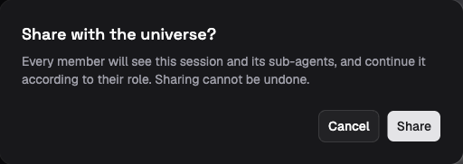

# Private and shared work

A standalone session you start in the web app starts private. Its creator and
the universe's Owners can see it. To bring the rest of the team into the same
conversation, share it with the universe.

## Share a session

Suppose you start a session to review Acorn's release. The header shows
**Private** while you work. When the review is ready for the team, open
**Session actions**, choose **Share with universe…**, then confirm with
**Share**. The header now shows **Shared**.

Sharing is permanent. It opens the conversation and its existing sub-agents to
everyone with access to the universe, including people who join later. Viewers
can read it. Contributors and higher roles can continue it, subject to their
permissions and the session's lifecycle.

## What each person may do

| Operation | Private session | Shared session |
| --- | --- | --- |
| Read | Creator and Owners | Everyone with access |
| Start runs, steer, cancel, or approve tool calls | Creator with Contributor access or higher, and Owners | Contributor or higher |
| Change session setup or override run options | Creator with Operator access, and Owners | Operator or higher |
| Close or force-close | Creator with Contributor access or higher, and Owners | Operator or higher |
| Share | Creator with Contributor access or higher, and Owners | Already shared |
| Soft-delete after closing | Owners | Operator or higher |
| Set deletion retention | Owners | Owners |

A creator downgraded to Viewer can still read their session as long as they
retain access to the universe. Organization Admins have Owner access within
their organization. Platform Admins have it across the deployment and can
permanently purge soft-deleted sessions. See [Close and retain a
session](../using-lightspeed/sessions-and-runs.md#close-and-retain-a-session).

## Who can see related work

A standalone session is the root of its conversation tree. Its sub-agents
inherit its visibility, including through further delegation. To share a
child session, share its root.

Bots and their conversations are shared with the universe, including the
sub-agents they start. Universe roles determine who can read bot activity,
invoke bots, or manage their settings. The [bot
guide](../using-lightspeed/bots-and-triggers.md) explains how conversations
relate to triggers.

## Files keep their own access boundary

If Acorn's agent writes findings to a shared workspace, other members can
read the files there while the conversation is still private. Files on an
attached machine and outputs sent to external services follow those resources'
own access rules.

A member with blob-read permission can also retrieve universe blobs by known
digest. Treat session privacy as a rule about who can open the conversation.
Trusted operators with direct runtime tokens have access to every session. See
[Tenant isolation and data protection](tenant-isolation-and-data-protection.md).
