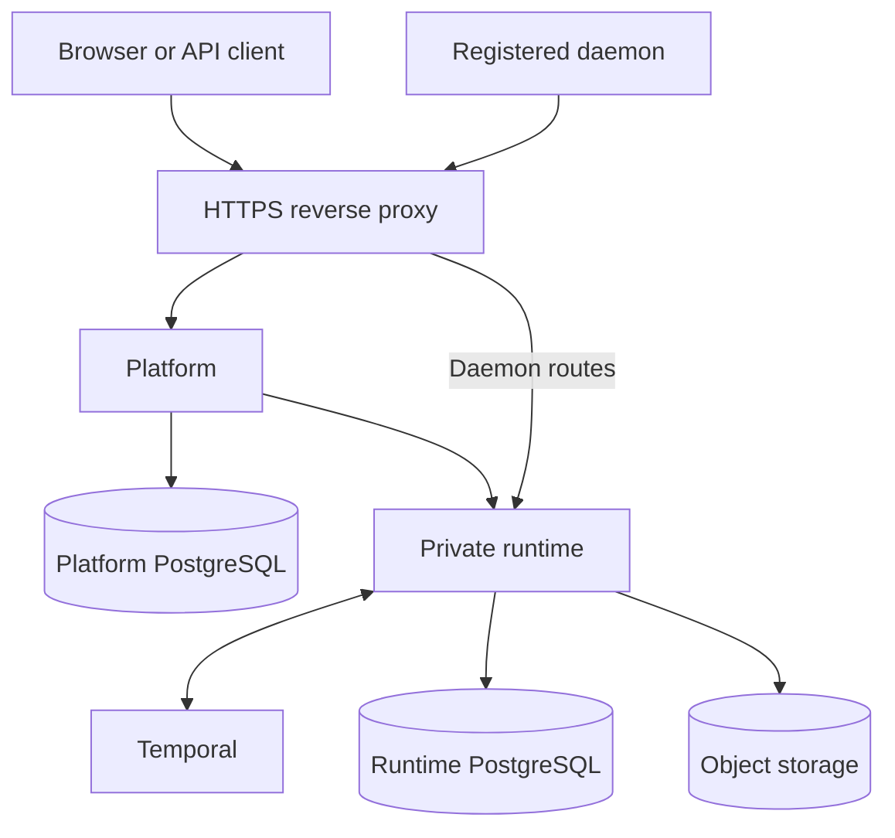

# Deployment overview

The Lightspeed runtime runs agents, bots, and environment connections.
Temporal coordinates durable work and PostgreSQL stores the product's
records. Add Platform for the web app, sign-in, and access control for
people and service users.

Start with one runtime process. Run roles separately when you need
independent scaling or placement.

## The components

| Component | Responsibility |
| --- | --- |
| Runtime | Serves the HTTP API and runs agent sessions and background workflows. |
| Temporal | Coordinates durable workflow execution. |
| Runtime PostgreSQL | Holds sessions, workspaces, credentials, and other runtime records. |
| Object storage | Stores content larger than 64 KiB. Small blobs stay in PostgreSQL. |
| Platform | Serves the web app and API, manages organizations, and authorizes requests. |
| Platform PostgreSQL | Holds login accounts, organization membership, universe grants, API keys, and Platform settings. |
| Environment daemons and providers | Give agents access to machines. Providers can provision machines and manage their lifecycle. |
| Configurator MCP | Optional service for configuring Lightspeed with a restricted Platform service-user key. |

Runtime and Platform can share a PostgreSQL server. Give each its own
database. Temporal has its own persistence requirements.

## Choose how clients connect

Point browsers, CLI users, and integrations at Platform when they should
have the access of a person or service user. The CLI can use a browser
sign-in or a Platform API key. Platform checks the caller’s organization
and universe access and then forwards runtime operations over a private
connection.

Set `LIGHTSPEED_AUTH_MODE=authenticated` for a hosted runtime. Platform
authenticates to it with `LIGHTSPEED_PLATFORM_API_TOKEN` or its `_FILE`
variant. Trusted components can call the runtime directly with a configured
runtime token. Each runtime token has authority across the deployment,
including private sessions. Keep the runtime application listener private
and publish only the required callback and daemon routes. The
[self-hosting guide](self-hosting.md#configure-the-public-edge) shows the
routing. For access decisions and key types, see
[Access and security](../access-and-security/overview.md).

Use `single` mode for private local development. It serves one configured
universe without authenticating requests.

## Runtime roles and scaling

| Role | Work it owns |
| --- | --- |
| `gateway` | HTTP API, OAuth callbacks, and bot webhook ingress. |
| `environment-gateway` | Connections to environments and environment lifecycle reconciliation. |
| `sessions` | Session workflows and activities, including session and blob retention. |
| `code` | Code Mode script execution. |
| `bots` | Bot controllers, triggers, and bot activities. |

All five roles run by default. Set `LIGHTSPEED_ROLES` to run a subset.
For example, `gateway,environment-gateway,sessions,code` serves sessions
and Code Mode without bot workers. Platform starts with **Bots** switched
off for each universe. Owners can enable it under **Settings → General → Features**.

Each worker role has a Temporal task queue. Give each deployment a distinct
set of queues if you share a namespace. To run multiple environment gateways,
give each replica a reachable private peer URL and the shared routing
token. See [Operate Lightspeed](operations.md#scale-the-process-that-does-the-work)
for scaling and [Networking and ingress](../environments/networking-and-ingress.md)
for environment routes.

## Persistence determines what survives

Keep coordinated backups of the runtime and Platform databases, Temporal,
and object storage. Retain the runtime secrets master key and Platform
authentication secret with the deployment's recovery material. Files on
execution machines follow those machines' own lifecycle. See
[Upgrades and recovery](upgrades-and-recovery.md#preserve-a-complete-recovery-set).

## The first self-hosted installation

Follow [Self-host Lightspeed](self-hosting.md) to run matching release
images on one Linux application host with existing PostgreSQL and Temporal.
The walkthrough starts with small blobs in PostgreSQL, then links to
storage, identity, and compute setup. For a local source checkout, use the
[development launcher](../development/local-development.md).
