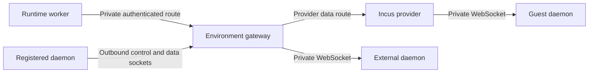
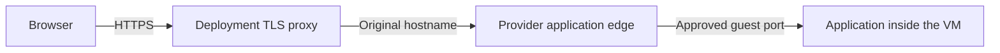

# Networking and ingress

The environment gateway carries file and process operations between the
runtime and a machine. If someone also needs to open a web application
running on that machine, configure a separate application endpoint.
Deployment operators set up the network routes. Publishing an application
requires Operator or Owner access in its universe.

## Follow an environment operation



For a file or process tool, the runtime finds the machine the session is
using. A registered daemon connects outbound. The gateway dials an externally
attached daemon directly or reaches a provisioned VM through its provider.

For multiple **environment-gateway** replicas, workers and daemons can use
stable load-balanced endpoints. Control and data connections can land on
different replicas. The gateways relay them over private peer routes.

Set `LIGHTSPEED_ENVIRONMENT_GATEWAY_PEER_URL` on each replica to its own
directly reachable HTTP(S) origin, such as its pod IP and listener port.
All replicas use the same `LIGHTSPEED_ENVIRONMENT_GATEWAY_TOKEN`. A single
gateway can omit the peer URL.

For an IPv4 Kubernetes Deployment listening on port 18083, the container's
environment can derive its address automatically:

```yaml
env:
  - name: POD_IP
    valueFrom:
      fieldRef:
        fieldPath: status.podIP
  - name: LIGHTSPEED_ENVIRONMENT_GATEWAY_PEER_URL
    value: "http://$(POD_IP):18083"
```

Allow gateway-to-gateway traffic on that port and use `/ready` for readiness.
Workers running separately from the gateway use its stable base URL in
`LIGHTSPEED_ENVIRONMENT_GATEWAY_URL` and authenticate with
`LIGHTSPEED_ENVIRONMENT_GATEWAY_TOKEN`. Keep that token within the deployment.

## Connect a registered daemon through a public edge

A registered daemon opens its connection outward, which lets it run behind
NAT without exposing an inbound daemon listener. Publish these runtime paths
through an HTTPS/WebSocket-capable proxy targeting the environment listener
(`LIGHTSPEED_ENVIRONMENT_GATEWAY_BIND`, default `127.0.0.1:18083`):

| Path | Purpose |
| --- | --- |
| `/environments/connect` | Long-lived daemon control connection and identity admission/reconnection. |
| `/environments/data` | Additional outbound data sockets opened when the gateway requests a worker route. |

Use `wss://` for a remote gateway. The daemon accepts plain `ws://` only for
loopback, unless `LIGHTSPEED_ENVD_ALLOW_INSECURE_GATEWAY` opts in for a
trusted private network. For a private certificate authority, configure
`LIGHTSPEED_ENVD_CA_FILE` with the additional trust anchors.

The daemon derives the data path from its configured connect URL, on the same
origin and under the same path prefix, so both paths must be published on one
host. The daemon signs the origin it dialed when it proves its identity, and
the gateway accepts the origin of its `LIGHTSPEED_ENVIRONMENT_PUBLIC_BASE_URL` plus those
listed in `LIGHTSPEED_ENVIRONMENT_REGISTRATION_URLS`, such as a
cluster-internal service address. A daemon that dials the gateway under any
other hostname is refused. [Run registered daemons](registered-daemons.md)
shows the in-cluster setup.

Both public paths need WebSocket upgrades and support for long-lived
connections. A machine can appear connected through the control path even
when operations fail because the data path is missing. Keep the
bearer-authenticated worker and replica paths under `/environments/routes/`
and `/environments/peer/` private. Reject both prefixes at the public edge.

Follow [Bring your own compute](bring-your-own-compute.md) for the complete
registration procedure. [Self-hosting](../deployment/self-hosting.md#configure-the-public-edge)
shows how to publish the daemon routes while keeping the runtime HTTP API
listener private.

## Reach passive daemons and Incus guests

An external environment stores a daemon endpoint that the deployment can
reach. The local development example uses `ws://127.0.0.1:19091/`. In a
container, that address refers to the container making the connection; choose
a protected reachable address for a different topology.

The passive daemon listener has no built-in authentication or TLS. Protect it
with the network or transport boundary. A filesystem root setting or default
working directory does not make a publicly reachable process service safe to
expose.

For Incus, allow the environment gateway to reach the provider's controller
and data routes. The provider then dials the daemon on the private guest
IPv4 network, normally on port 19091. Keep that network private because the
guest listener has no authentication of its own. Standalone Incus uses a
managed bridge per universe. Cluster mode uses a managed OVN network over
the configured uplink. The provider and its application edge need routes to
those guest addresses as well as access to the Incus API. See
[Incus VMs](incus-vms.md) for endpoints and egress controls.

Proxies between a worker and daemon must pass WebSocket pings, allow at
least 60 seconds of inactivity, and accept messages up to 16 MiB. An idle
relay can reopen on the next operation while the daemon remains available.

## Configure public application ingress

The Incus provider can publish one template-approved guest port over HTTP and
WebSockets. It does not expose arbitrary TCP services or let a session choose
its own public hostname, private target address, or forwarding port.

The application edge does not authenticate visitors against Lightspeed users,
universes, or session cookies. Anyone who can reach an enabled endpoint can
reach its application. Supply access control in the application or deployment
proxy when the service requires it.

As the operator, add an `ingress` block to the provider configuration:

```json
{
  "ingress": {
    "publicBaseUrl": "https://env.example.com",
    "listen": "127.0.0.1:19092"
  }
}
```

This is a fragment to merge into the full configuration from
[Incus VMs](incus-vms.md#configure-and-start-the-provider). Define an
ingress-capable template with its own stable template ID and these additional
fields:

```json
{
  "publicIngress": true,
  "ingressPort": 8080
}
```

Both template fields are required together, and the provider ingress block
must exist. Ports 0, 22, 2375, 2376, and the daemon's own configured port are
reserved and cannot be exposed this way. Restart the provider after changing
its configuration, then provision a machine from the intended template.

For this example, configure wildcard DNS and TLS for `*.env.example.com` at
the deployment proxy. Forward those hosts to the provider edge listener,
preserving the original `Host` header, streaming responses, and WebSocket
upgrades. The edge listener itself serves plain HTTP; the deployment proxy
terminates HTTPS.

Keep the provider controller and private daemon routes out of that public
application proxy. A certificate-issuance authorization hook, if used by the
TLS setup, does not provide visitor authentication.

## Publish a small application

Use a ready environment created from the ingress-capable template. The
application must bind the approved port on a guest-reachable address, such as
`0.0.0.0:8080`, rather than only the guest's loopback interface.

For a minimal test on a machine with Python 3 installed, ask the agent to
create a dedicated directory containing only a harmless test page and run:

```bash
mkdir -p ingress-demo
printf 'Acorn environment is reachable\n' > ingress-demo/index.html
python3 -m http.server 8080 --bind 0.0.0.0 --directory ingress-demo
```

Run the server as a [tracked environment process](processes-and-jobs.md) and
keep the process handle so you can stop it after the check.

In **Environments → Details**, choose **Enable public ingress** and open the
generated HTTPS endpoint. The page should show `Acorn environment is
reachable`. Use the returned URL rather than constructing a hostname from
the display name.

This verifies application delivery separately from environment tool access:



## Keep application lifetime and power aligned

The route is useful only while the application and machine are available.
Public requests do not reset the daemon's idle activity clock, and browser
access does not wake a sleeping VM. A sleeping target can therefore return
404 even though ingress remains configured.

A running process keeps the machine awake, and so does a service that a
command started and left running after it exited. Choose a template whose
idle policy matches how the application should remain available; see
[Power and cleanup](power-and-cleanup.md#set-an-idle-policy).

Choose **Disable public ingress** to remove the route, then stop the tracked
server separately. Stop the server to end existing connections as well.
Save any useful output before closing a disposable VM. The equivalent API
operation is `environments/ingress/put` in the
[API reference](../../../crates/api/contract/api-reference.md).

## Locate a connection failure

| Symptom | What to check |
| --- | --- |
| A registered daemon connects but commands cannot route | Publish both connect and data paths; check WebSocket handling and gateway peer reachability, matching deployment tokens, and live instance leases. |
| Worker calls fail while the daemon looks healthy | Check the worker's gateway URL/token and private route reachability. |
| Incus health passes but guest operations fail | Check guest daemon readiness, guest IPv4 routing, and the provider-to-daemon port. |
| A loopback endpoint works locally but fails in containers | Replace it with the private address reachable from the actual connecting process. |
| **Enable public ingress** is absent or disabled | Check that the template offers public ingress, the provider's ingress configuration, and that the environment is open. |
| The public endpoint returns 404 | Check the original Host header, enabled route, and whether the target is ready rather than asleep. |
| The public endpoint returns 502 | Check the edge's Incus lookup and connectivity to the application on the approved guest port. |
| HTTP works but WebSockets or long responses fail | Check upgrades, streaming, and timeouts at the deployment TLS proxy. |

The [environment-variable reference](../reference/environment-variables.md#environment-services)
and [Incus provider guide](../../../crates/environment-provider-incus/README.md)
hold the exact deployment configuration surfaces.
