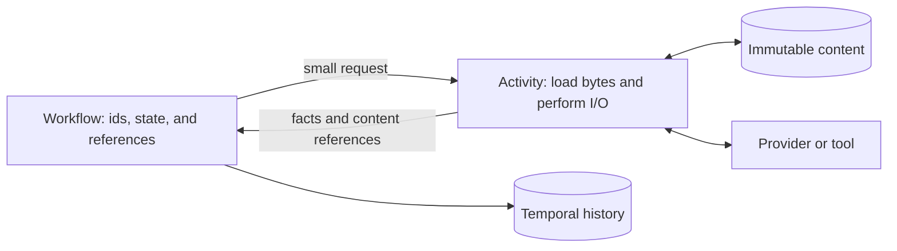

# Context and storage

A session can remember something without sending it to the model on every
turn. Suppose the release editor has already written three drafts of the
Acorn release notes. Its history records the requests, tool calls, and results
that produced them. The next request may need the current instructions and a
compacted account of the work, with the latest draft available in a workspace
for the agent to read.

Lightspeed keeps three things distinct: the event history records what
happened, active context determines what the next turn will consume, and
content-addressed storage holds the immutable bytes those records refer to.
This distinction explains how the conversation can remain inspectable while
its model context changes over time.

## Give content an identity independent of its current use

A content descriptor, `ContentRef`, identifies immutable bytes by their
SHA-256 hash, media type, and optional provider encoding. The same bytes can
serve as a context input, a historical message, or a run's final output without
being copied or converted into display text.

A context entry adds how that content is used: its role, source, position, and
an optional preview. The preview helps people inspect an entry; the model
receives the referenced content. Provenance can link to source material, such
as the original audio behind a transcript or a report of how instructions
were assembled. These source labels describe content; they grant no access.

Active context has a revision and ordered entries. Adding, removing, or
rewriting entries happens through events. An entry removed from the active
set still has the event that introduced it in session history. Replaying that
history reconstructs both the earlier state and the later removal.

`session/context/replace` lets an authorized caller repair an active user message or
tool result by entry ID. Replacement retains its ID, kind, and position, and
a tool result remains paired with its call. The operation is refused during
an active run and reports an outcome for each entry. Redaction through the
CLI uses this same operation with a placeholder; original events and blobs
remain retained. See [Repair rejected context](../using-lightspeed/cli.md#repair-rejected-context).

Provider adapters can also transform media for a particular request without
changing active entries. Image normalization sends a bounded copy; request
media budgeting replaces older items with handle-bearing omission notes.
Stored references, previews, and downloads still identify the originals.
[Tool media](../using-lightspeed/tools-and-mcp.md#see-images-and-documents-from-tools)
describes those limits.

## Keep provider-native material at the provider boundary

Provider responses contain more than visible text. They can include tool calls,
citations, reasoning signatures, opaque continuation data, and other structures
needed for a subsequent request. Flattening every response into a generic
message would require inventing a common representation for all of that data,
then reconstructing the provider's representation later.

Lightspeed keeps the native payload and extracts the smaller facts needed by
the core. The harness needs to know that generation completed, which tool calls
were admitted, and what context entries resulted. The provider adapter owns
the decoding and request construction.

The supported routes preserve their data in different ways:

| Route | Stored assistant material |
| --- | --- |
| OpenAI Responses | The original native message item, with native reasoning and tool items represented by their appropriate semantic entries. |
| Anthropic Messages | Consecutive text blocks form one native message, retaining block data and citations; reasoning and other native content retain their required continuation material. |
| Chat Completions | Assistant content, refusal, and annotations stay together; separately recorded tool calls and reasoning entries fold back into the corresponding assistant turn. |

API projections derive visible text and citations from these bytes. They do
not replace the native payload with a second authoritative text copy. Opaque
reasoning data can therefore remain intact while the UI shows only the visible
reasoning text the provider exposed.

Each adapter rebuilds requests according to its provider's format and allowed
fields. Keeping native material does not make histories interchangeable across
API kinds. A session's provider and API kind are fixed; start a new session to change
them. Within that route any model is allowed, and retained reasoning and native
compaction state are sent as they are. Whether the new model makes use of them is
the provider's call. If a provider refuses a combination, the run fails as
`requestRejected` with the provider's message, and the session stays open so the
user can switch back.

Durable model selection contains the provider ID, API kind, and model name.
The endpoint, authentication, and transport headers are resolved outside the
harness immediately before provider I/O. This allows credentials to change
without storing their secret values in the session's deterministic state.
See [Models and credentials](../using-lightspeed/models-and-credentials.md)
for the resolution rules.

## Assemble a turn from recorded inputs

Before an idle session admits new run work, the session workflow refreshes
material derived from its attached workspaces and selected environment. That
includes enabled prompt sources, skill catalogs, the environment catalog, and
the sub-agent menu. The
gateway submits the run without first repeating this discovery. Session setup,
configuration changes, and explicit skill reads retain their own refresh paths.
The admission refresh occurs when no run is active or already queued; it is not
an unconditional refresh before each previously queued task.

Prompt discovery reads configured sources in VFS workspaces and the selected
environment. It records an assembly report so readers can see where the
instructions came from and which sources were omitted. An oversized source
is omitted whole instead of becoming truncated instructions.

Skill discovery supplies a catalog of available skills. The model reads the
chosen skill's document when it needs the procedure. Its body then follows
ordinary conversation retention and compaction; the current catalog remains
available. [Workspaces and skills](../using-lightspeed/workspaces-and-skills.md)
explains the source locations and how to configure discovery.

Once the refreshed inputs are admitted, the turn freezes the context revision
it uses. Instructions are ordered first by key; other entries follow their
recorded positions, except that a tool group renders together: each result follows
its call, and anything that arrived inside the group, such as a note or a result's
media, goes behind its last result. The log keeps arrival order, so the transcript
can differ from the request in that case. The adapter reads the referenced bytes,
builds the native request, and sends it with the effective model and tool catalog.
New steering can be admitted while that call is in flight, but it applies at a later
turn boundary, after any open tool batch, rather than changing a request already
sent.

For the release editor, editing workspace instructions can change a later
request. It cannot change the request already sent to the model. Reading a
workspace file produces a tool result that records what the agent saw at that
point in time.

## Preserve useful request prefixes

Providers can reuse a cached request prefix when the same material appears at
the start of later requests. Lightspeed keeps ordering stable and appends
catalog updates so they do not rewrite an otherwise reusable prefix.

A catalog tells the model what is available: workspaces, skills, environments,
or sub-agents. Its rendered text is stored in CAS along with a structured
source snapshot. Replaying an old catalog uses the stored text, so a change
to the renderer cannot change an earlier request. Runtime catalogs are managed
by the session workflow; clients can publish their own catalogs under separate
keys through the [context API](../../../crates/api/contract/api-reference.md).

When a keyed catalog's title or rendered content changes, the new version is
appended at the context tail. Earlier versions remain in their original
positions, with their bytes unchanged. The new entry identifies which catalog
it supersedes. A metadata-only refresh instead records an in-place replacement
that preserves the entry ID, position, text, and supersession link. Replay
reconstructs either path, so fresh discovery diagnostics need not append an
identical message or disrupt a cached prefix.

Catalog text describes available resources rather than constantly changing
status. The environment directory includes references, display names, default
markers, and access; selection, lifecycle state, and working directories come
from `environment_read`. Skills list names, descriptions, and `SKILL.md` paths,
sorted by visible path. VFS mounts describe workspace or snapshot storage and
access without printing internal IDs or snapshot hashes. Revisions and
discovery details remain structured provenance.

Failed environment skill discovery can retain a matching prior catalog as
stale, with API warnings, while leaving its rendered paths unchanged. Matching
requires the same environment and configured discovery scope; changed roots,
working directory, access, or a revoked attachment invalidate that fallback.

Active context retains at most five superseded versions per catalog. They follow
conversation retention, so compaction removes only those inside the prefix it covers.
Instructions and other ordinary keyed entries replace their earlier version, so
editing instructions can change the beginning of the next request. A replaced
non-instruction entry goes last under a new ID.

Tool definitions also keep a stable order. Reordering an otherwise identical
set of tools can change the prefix the provider sees.

The adapters then use each provider's cache controls. OpenAI Responses and
Chat Completions generation supply a stable session-derived `prompt_cache_key`.
Anthropic generation places ephemeral cache markers on the assembled system
prompt, the last eligible non-deferred tool, and the last eligible message
block. Supported provider parameters can configure the marker TTL.

The provider decides whether a request hits its cache. Stable ordering and
cache controls improve the opportunity for reuse without guaranteeing a hit.

## Compact the active conversation

Compaction replaces part of the active conversation with a smaller account
that can support later turns. It is a lossy context transformation. The original
session events and output descriptors remain in history, so this is separate
from deleting stored data.

Automatic policy and an individual compaction operation are separate:

| Setting | Automatic behavior |
| --- | --- |
| **Engine default** (omitted policy) | New sessions and configuration replacements resolve to harness-managed standalone compaction. |
| `providerStandalone` | The harness schedules standalone work at safe boundaries between generations, including during an active run. |
| `providerTriggered` | Supported OpenAI Responses and Anthropic Messages routes compact inside generation. Chat Completions rejects this mode. |
| `disabled` | No automatic compaction or context-limit recovery. Explicit API compaction remains available. |

An explicit `compactThresholdTokens` controls the proactive trigger. Otherwise it uses
80% of known usable input capacity. `context.inputLimitTokens` can supply an explicit
capacity for the document's model; without one, the capacity the provider reports for
the run's model is resolved when each run is prepared. A failed lookup leaves that run
on error-driven recovery, without inventing a numeric limit. Request occupancy and the
effective model's capacity are recorded facts for the deterministic harness;
cumulative billed tokens are not window occupancy.

Proactive compaction works for a run. It fires at a safe boundary of an active run,
including the start of a new run before its input is written, and never on an idle
session. So a session nobody returns to pays nothing, and a user's next message can
wait behind a compaction.

Two more rules keep long sessions loadable, because every generation's activity input
and reduced state carry metadata for each active entry, whatever the token count:

- At 1,500 active entries compaction fires on every enabled policy. That includes
  `providerTriggered`, which runs a standalone compaction here.
- At 2,000 active entries a run does not go on with no compaction tried. It gets one
  attempt, which covers the whole settled window, and fails as `contextFailure` if the
  count stays over. A session on `disabled` fails each run at its next turn boundary
  from that point. The way out is to enable compaction or call
  `session/context/compact`. A run stopped before its first turn has its input only in
  the log, so the next run's model does not see it. The limit exists because reduced
  state crosses the size a session can load near 3,000 entries.

A failed proactive attempt backs off: either trigger waits for about 10% growth past
the point that failed, and any success clears that. Overflow recovery and manual
compaction are not held back.

When an enabled session reaches a typed provider context-length failure, the
harness can compact and resume the same run using already-recorded tool
results. Recovery is bounded to two attempts per consecutive overflow
sequence. Authentication failures and unrelated request rejections do not
trigger this path. If protected input cannot fit, or recovery cannot produce
a usable replacement, the run fails with the source context retained. When the
smallest chunk still overflows, the failure names the largest entry and its rough
size, so a user can replace it by ID with
[context repair](../using-lightspeed/cli.md#repair-rejected-context) or start a new
session.

Where a limit is known, run start and steering refuse a single text entry that could
never fit, with `invalidRequest`, rather than admit a message that fails every run
after it. The check counts 4 bytes per token, so it is an estimate, and it does not
cover images, PDFs, or `session/context/append`.

`session/context/compact` requests one standalone operation in any mode,
including Disabled, without changing automatic policy. Active work queues it
until the current generation and tool work reach a safe boundary. The harness
records the covered prefix and context revision, then commits a validated
replacement atomically. Failed or stale results cannot erase newer context.

The standalone adapter depends on the route and its supported capabilities:

| Route | Standalone operation |
| --- | --- |
| OpenAI Responses | The Responses compact endpoint; retain the complete returned native window, including its encrypted state. |
| Anthropic Messages | Native on-demand compaction on supported models; retain the signed block unchanged. Older models use a Lightspeed-authored summary generation. |
| Chat Completions | A Lightspeed-authored summary generation. |

An explicitly unavailable native operation can fall back to summarization on
the same provider, endpoint, and model. Ordinary invalid requests do not
authorize that fallback. Summary adapters use `targetTokens` as guidance and
an output budget; native operations do not guarantee that output size.

A retained Anthropic on-demand signed block requires subsequent compactions
to use standalone execution, even if the requested policy was provider
triggered. The effective strategy reflects that transition.

Instructions and current catalogs survive compaction. The harness protects
unconsumed input and unanswered tool exchanges, and normally keeps the two
newest settled exchanges with their preceding user input while compacting an
older prefix. Manual compaction without an older prefix and repeated overflow
recovery can cover more settled history. Skill reads and superseded catalogs
follow conversation retention. The adapter processes bounded chunks, but only
the complete validated replacement changes active context. Its size estimates only
choose where to cut: a chunk with no smaller cut goes to the provider, and the
provider's typed overflow decides.

Session settings and the API's active-context projection report effective
mode, threshold source, queued or pending work, and recovery attempts. See
[Sessions and runs](../using-lightspeed/sessions-and-runs.md#manage-long-conversations)
for the user controls.

## Keep large bytes outside Temporal history

Temporal records activity inputs and results as part of durable execution.
Passing a full conversation, file, or provider response across that boundary
every time would make its history grow with payload size as well as with the
number of operations.

Activities instead write payloads to CAS and return references plus the facts
needed for branching. A later activity loads the content when constructing
its request. Both directions use the same principle:

Equal bytes share a logical content reference within one universe. Catalog
rows and external object keys are universe-scoped even when tenants share
PostgreSQL and object storage. A known hash is not an authorization to read
another tenant's content.

In the hosted store, blobs up to and including 64 KiB remain inline in
PostgreSQL. Larger blobs require configured object storage. Without it, writes
above that limit fail. PostgreSQL continues to hold their catalog entries and
physical object keys. [Deployment configuration](../deployment/configuration.md#choose-the-blob-backend)
explains this operational choice.

Each external upload has its own physical object key. If content is collected
and later uploaded again, delayed cleanup of the old object cannot delete the
new copy.

## Build persistent files from immutable content

The VFS uses the same storage primitive. A snapshot manifest describes a
directory tree and references its files' immutable content. Editing one file
creates new content and a new manifest while unchanged file blobs can be
reused. This is similar to the useful part of a versioned source tree: a
snapshot identifies a particular view without requiring every file to be
copied again.

A workspace adds a named, mutable head over those snapshots. Updating that
head uses a revision check so a writer does not silently overwrite another
writer's move. A snapshot attachment pins a particular version; a workspace attachment
resolves its current head at the relevant operation boundary.

None of this overlays a machine filesystem. VFS file edits and environment
process files remain distinct. [Workspaces and skills](../using-lightspeed/workspaces-and-skills.md)
describes their user-facing behavior.

## Retain bytes through recorded ownership

Immutability makes content reusable, but it also raises a practical question:
when can storage reclaim it? Lightspeed answers through durable holders and
explicit parent-to-child edges.

Appending session events records the references held in their typed fields as
session roots in the same database transaction. Missing referenced blobs reject the
append, and constraints protect references attached concurrently with cleanup.
Bot events, reducer checkpoints, and VFS records also retain the content they
own.

A container also records which content it retains: a snapshot keeps its file
blobs, and an instruction assembly report keeps its sources. Formats must
declare these relationships. A hash-shaped string in arbitrary payload bytes
is not enough to keep the referenced content alive.

The collector can remove an old blob only when no durable holder or incoming
edge protects it. Removing a parent can release its children for a later pass.

An elected collector runs hourly with bounded scanning. The default grace is
seven days since the last put or API admission of an existing reference;
reading content does not renew that grace. Permanent session deletion releases
its roots; soft deletion retains them. Compaction also leaves roots intact
because session history still records the original content. Reducing a model window and reclaiming disk
space are therefore separate operations.

Profiles borrow their content references rather than holding blobs indefinitely.
Workflow state alone is not a holder either. Ordinary uncommitted activity
handoffs rely on the grace period; a handoff stalled beyond it can lose content
and require resubmission. [Operations](../deployment/operations.md#manage-retention-and-blob-collection)
documents the collection bounds and diagnostics.

## Read the view that answers the question

The transcript shows what happened by reading and projecting a range of
historical events. It can page through old work while live updates continue
from the current session head.

`session/read` answers from the store and needs no worker. It uses a reducer
checkpoint and the authoritative event tail, falling back to full replay when a
checkpoint is unusable. Incomplete required history fails explicitly in both paths.
For a session that is not closed it also asks Temporal whether the execution is
running, and reports `executionFailure` if not. If Temporal cannot answer, the read
logs a warning and reports stored state, so a session can read as healthy during an
outage.

Run summaries come from reduced state for the last 256 finished runs and from the
log for older ones. `session/runs/read` projects one run from its events. A run past
the server's detail limit keeps its opening and its latest whole turns and sets
`earlierEventsOmitted`; `session/events/read` serves the rest.

Detailed run reads also retain a terminal output descriptor independently of
active context. A completed native message can still supply its full projected
text after context compaction removes it from the next model request. Visible
reasoning and message text are projected in full; tool and catalog previews
remain bounded, and the original bytes remain available through blob reads.
An output can describe media without inventing a text representation for it.

Images and PDFs use content descriptors too, whether they arrive as user
input, a tool result, or a sub-agent result. The model sees a stable `media:`
handle it can use to refer to the attachment; clients resolve that handle
against the descriptors exposed by the API.

Explicit VFS references use a separate `file:` handle and typed file
descriptor. `vfs_reference` resolves an immutable file version; reads and
writes do not implicitly publish file attachments. The descriptor travels
with a sub-agent result only when its successful final answer cites that
known attachment. The receiving session records the descriptor and retains
the bytes, without needing the child's workspace or session.

Clients resolve these handles against recorded attachments, including those
from historical completion pages. Unknown or ambiguous handles are
unavailable. A source workspace and path provide optional navigation; they
do not determine which bytes the attachment opens. Short handles grant no
access, and a hash in prose alone is not a retention root.

Together, these views let the model work with a manageable context while
people inspect retained history and the runtime reconstructs execution state.
