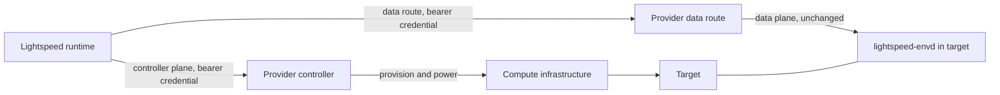

# Implement an environment provider

An environment provider supplies managed compute through Lightspeed's
environment protocol. It translates requests such as creating, waking, or
closing an environment into the infrastructure it controls, then routes
Lightspeed to the daemon running inside that environment.

The provider implements the controller plane of the
[environment protocol](../reference/environment-protocol.md). It does not need
Lightspeed's database, API implementation, harness, or Temporal runtime. The
included Incus provider demonstrates that separation. If you only need to
connect an existing machine, [outbound daemon registration](../environments/bring-your-own-compute.md)
already provides that path without implementing a controller.

## Separate control from execution

The controller manages targets: VMs, containers, sandboxes, or other units of
compute owned by the provider. Inside each target runs `lightspeed-envd`, the
daemon that serves filesystem, transfer, process, and job operations. The
provider supplies compute and routing; it does not reimplement the daemon.
A target that exists in infrastructure is not necessarily ready to serve
data operations.



The two planes have separate version numbers. A provider speaks
`CONTROLLER_PROTOCOL_VERSION`; the daemon in its targets speaks
`ENVD_PROTOCOL_VERSION`. Both are matched exactly, and both are currently 3.
A provider that never parses data-plane messages, and only relays them,
does not depend on the daemon's number. A provider that bakes the daemon
into its images still has to ship images whose daemon matches the runtime.

## Serve the controller endpoint

The controller is one WebSocket endpoint. The operator registers its URL in
Lightspeed together with a provider credential. The URL may use `ws://`,
`wss://`, or `unix:///absolute/path`, under any path; the Incus provider
uses `/control`. Use `wss` whenever the controller is reachable beyond a
single host.

Every connection to the controller and to each data route carries
`Authorization: Bearer <credential>`. Compare it in constant time and refuse
a missing or wrong credential with HTTP 401 before the WebSocket upgrade.
Treat the credential as a secret in the provider's own configuration, as the
Incus provider does with its `credentialFile`.

Run the shared JSON-RPC envelope and handshake on that socket. `initialize`
comes first, a repeat is `invalidRequest`, and another protocol version is
`versionMismatch`. The response names the `controller` plane and carries two
facts the runtime records on the provider:

```json
{
  "protocolVersion": 3,
  "plane": "controller",
  "serverInfo": {"name": "example-provider", "version": "1.2.0"},
  "capabilities": {"adoptTarget": false, "ingress": true},
  "routes": {"data": "wss://provider.example.com/routes"}
}
```

`capabilities` lists the optional features. `adoptTarget` serves
`target/adopt`; `ingress` serves `ingress/ensure` and `ingress/remove`.
Everything else is mandatory at this version. The runtime never calls an
optional method the controller does not advertise and refuses the
corresponding API requests up front. If one arrives anyway, answer
`capabilityUnavailable`.

`routes.data` is the base URL of the data routes. Lightspeed never derives it
from the controller URL. A controller served over `wss` must advertise a
`wss` base; the runtime refuses a downgrade.

## Implement controller operations

| Method | Provider responsibility |
| --- | --- |
| `template/list` | Return the approved templates available to the supplied universe and binding. |
| `target/create` | Return the owner's existing target, or apply template policy and start creating one. |
| `target/adopt` | Take over an existing target named in your own format, when you advertise `adoptTarget`. |
| `target/get` | Observe the target without changing anything. |
| `target/setPower` | Converge toward one of the target's supported power states. |
| `target/close` | Destroy everything the owner's target holds, ingress included. |
| `ingress/ensure`, `ingress/remove` | Apply or remove provider-approved application exposure, when you advertise `ingress`. |

A create request carries the target's owner and a template selection:

```json
{
  "owner": {
    "universeId": "u1",
    "bindingId": "primary",
    "environmentId": "env_1",
    "incarnationId": "inc_1"
  },
  "templateId": "ubuntu-24.04-small"
}
```

This comes from the protocol's
[create fixture](../../../crates/environment-protocol/fixtures/controller/target.create.json),
which also shows the response and a typed error. The request does not carry
an arbitrary image, private address, or cloud-init document. Your template
policy decides what the caller may provision.

Every target and ingress method answers `{"target": <observation>}`.
The [protocol reference](../reference/environment-protocol.md#controller-plane)
states each method's rules and errors.

### Answer promptly

Every method returns within a few seconds. Slow work, such as an image pull,
a boot, or a graceful shutdown, continues in the background. The runtime
follows it with `target/get`. Container and cloud APIs are usually
asynchronous already: answer `target/create` with `phase: provisioning` as
soon as the request is accepted, even before your backend has assigned an
id, and include `targetId` in the first observation that has one.

### Make ownership survive retries

A target belongs to exactly one owner: universe, binding, environment, and
incarnation. You hold at most one target per owner. An ambiguous
infrastructure response is normal: a create can succeed while its response is
lost. `target/create` and `target/adopt` are therefore idempotent per owner.
When the owner already has a target, return its observation and apply no
creation policy, so deprecating a template never affects existing targets.

Every target method names the owner in a target reference,
`{owner, targetId?}`. Without `targetId`, resolve the owner's target yourself.
This is how Lightspeed closes a target whose id it never learned, so
`target/close` must work by owner alone and answer `closed` without a
`targetId` when you hold nothing for that owner. A target that belongs to
another owner is `failedPrecondition` (`ownerMismatch`). Knowing a native
target id is never enough: an old incarnation must not reach its
replacement or destroy it during delayed cleanup.

The Incus provider derives deterministic names from the owner and records
`user.lightspeed.*` ownership metadata on its native resources, so it can
restart and reconcile without a private database. Another provider can use
labels, tags, or its own store, but must preserve the same properties.

Adoption transfers ownership. In the Incus implementation, it replaces the
source VM's networking and profiles with the binding's policy, and a later
close destroys the adopted VM. Document your adoption format and effects as
part of your provider's contract rather than presenting adoption as a
harmless label change.

### Report what you observe

An observation has two axes. `state.phase` is `provisioning`, `active`,
`closing`, `closed`, `failed`, or `unknown`. While `active`, `state.power` is
`running`, `paused`, `suspended`, or `stopped`, in provider-neutral terms:
a paused container and a frozen VM are both `paused`. `supportedPowerStates`
lists only the states `target/setPower` can actually reach.

Report infrastructure observation, not the state a caller requested. Set
`state.daemonReady` only once your own probe reached the daemon on the
target's data route; a WebSocket upgrade is enough, and you need not speak the
daemon's protocol. Until then, a running machine stays `daemonReady: false`.
When a target is `failed` or `unknown`, or a transition waits for something,
say why in `state.message`; Lightspeed shows it to users as the environment's
lifecycle error.

A target that no longer exists is `notFound` from `target/get`. Lightspeed
records the environment as failed, so a target deleted out of band is noticed
on the next observation.

### Close means destroy

`target/close` removes everything the owner's target holds, its public
ingress included. Stop gracefully within your own bound, then force. Answer
`closing` while that runs and `closed` once nothing remains. Repeated close
calls are expected and must observe the same outcome. Lightspeed never calls
`ingress/remove` before close; that method exists only to disable ingress on
a target that stays.

### Expose ingress through policy

Ingress follows provider policy. A request identifies an owned target; it does
not let callers choose ports or upstream addresses. A template advertises
`publicIngress`, and the provider decides the approved port and endpoint.
Report the realized endpoint in the observation's `ingress`, absent when
disabled; the runtime converges the environment's recorded intent against
that field. See [Networking and ingress](../environments/networking-and-ingress.md)
for the user-facing behavior.

Templates report their size as typed `resources`: `vcpus`, `memoryBytes`,
and `diskBytes`. Use `metadata` only for display facts, such as an image
fingerprint.

### Return typed errors

Use the protocol's error kinds, each with its fixed integer code. Lightspeed
branches on them:

| Situation | Answer |
| --- | --- |
| Your backend API is unreachable or overloaded | `unavailable` or `busy`, optionally with `retryAfterMs`. The runtime retries. |
| The template is deprecated or the target's owner differs | `failedPrecondition` with `templateDeprecated` or `ownerMismatch`. |
| The template or target does not exist | `notFound`. |
| A power state is not supported | `invalidParams`. |
| A power change on a target that is not active | `failedPrecondition` (`targetNotActive`). |

Retryable kinds, `internal`, transport failures, and timeouts keep the
environment's status and are retried. If such errors persist for 30 minutes,
the environment fails with the last error. Other refusals fail a provisioning
environment at once, so reserve them for requests that can never succeed.

## Serve the data routes

A target's data route is your advertised base followed by
`/{universeId}/{bindingId}/{environmentId}/{incarnationId}/{targetId}`, each
segment percent-encoded. Lightspeed dials it with the provider credential.
Check that the owner in the path owns the target, then connect the socket to
the daemon in that target and relay frames unchanged in both directions.

A relay is an intermediary under the protocol's liveness rule:

- Forward ping and pong frames, and count every frame as activity.
- Never close a connection for idleness sooner than 60 seconds. A client
  waiting on a long read pings every 20 seconds and otherwise sends nothing.
- Accept and send WebSocket messages and frames of up to 16 MiB.

The data socket carries `secretEnv` values in plaintext. Use TLS or a
protected network on every hop, and keep those values out of logs, provider
metadata, and traces. The [credential guide](../environments/credentials.md)
describes the policy around them.

## Run the daemon in your targets

Install `lightspeed-envd` in every target and start it as a passive listener
the data route can reach, for example on a private port or a Unix socket.
Configure it with environment variables; the
[daemon reference](../reference/environment-variables.md#environment-daemon)
lists them.

- Set `LIGHTSPEED_ENVD_CWD` to the agent's working directory and, when the
  agent should see only part of the filesystem, `LIGHTSPEED_ENVD_FS_ROOT`.
- Set `LIGHTSPEED_ENVD_STATE_DIR` to a directory outside the working
  directory that survives the restarts you intend to support, such as
  `/var/lib/lightspeed-envd`. It holds job records and output, process spawn
  records, and the transfer journal. The daemon refuses every data-plane
  path inside it.
- Run the daemon as a user whose permissions fit the work. Commands run as
  that user, and the filesystem root is a boundary for data operations only,
  not for commands.

The daemon reports a new `daemonInstanceId` after every start. Process
handles from an earlier instance answer `notFound` with reason
`daemonRestarted`, and unfinished jobs become `interrupted`. A container
runtime that restarts the daemon's process or replaces the container is
therefore visible to callers; avoid restarting a daemon that serves work.

`env/getIdle` reports how long the environment has been idle. Lightspeed's
power reaper reads it before pausing, suspending, stopping, or closing a
target under an idle policy. Running processes and jobs keep `idleForMs` at
zero; handshakes, idle reports, and discovery scans do not count as use.

## Test the provider

Start with the protocol's fixtures and the two conformance suites. They need
no Lightspeed deployment:

```bash
cargo test -p environment-protocol
cargo test -p environment-client
```

The controller suite in
[`environment_client::conformance::controller`](../../../crates/environment-client/src/conformance/controller.rs),
behind the client crate's `conformance` feature, drives your controller URL
with your credential and one template. It checks the handshake rules, the
HTTP 401 refusal, the data-route downgrade rule, per-owner create
idempotency, that `target/get` never creates, owner fencing, close by owner,
and `capabilityUnavailable` for unadvertised features. It creates and closes
one target, so run it against a disposable account or project. Lightspeed
runs the same suite against its fake controller in CI, and the
Incus provider's live suite runs it against a real Incus server.

The data suite in
[`tools::environment_protocol::conformance`](../../../crates/tools/src/environment_protocol/conformance.rs)
drives a data endpoint through a data client. Point it at one of your
targets through your data route to verify that the relay passes the daemon's
behavior through: writes and reads, confinement, walks, process output and
exits, and job identity. It works in a fresh directory and removes it.

The suites do not cover everything. Also exercise ambiguous create retries,
cross-binding access, stale incarnations, daemon startup lag, relay idle
behavior during a quiet long read, every advertised power transition, a close
of a target whose create failed midway, and ingress teardown.

## Register and verify it in Lightspeed

Register the provider through `deployment/environment-providers/put` with its
controller endpoint and credential. The credential is write-only: it is
required for a new provider, kept when omitted, and never returned.
Registration runs the controller handshake. A refused upgrade, such as HTTP
404 for a wrong path or 401 for a wrong credential, another plane, or a data
route that downgrades a `wss` controller, refuses the registration. A
controller that cannot be reached yet is accepted, and its features and data
route are recorded at the first successful handshake.

Create an enabled universe binding and inspect the returned templates. The
[Incus setup guide](../environments/incus-vms.md) shows the registration and
binding procedure; use your provider's controller URL, credential, and
templates.

Create an environment, wait for it to become ready, read and write a
disposable file, and run a harmless command. Exercise each advertised power
state, wake it, and close it. Confirm that the infrastructure target and any
ingress are actually removed, and that a stale identity cannot reach a
replacement.

| Symptom | What to inspect |
| --- | --- |
| Provider registration is refused | Controller URL path, credential, plane, and the `wss` downgrade rule for `routes.data`. |
| The target runs but the environment never becomes ready | `daemonReady`, the daemon's startup, and the data route's reachability from the gateway. |
| The environment fails with a version message | The daemon in your image speaks another protocol version than the runtime. Rebuild the image. |
| An environment stays provisioning with a lifecycle error | Transient controller errors are being retried; the error names the last failure. |
| Retrying create allocates another target | Ownership is not resolved before creation policy runs. |
| Long reads fail after about a minute | A relay closes quiet connections or drops pings. |
| A closed target still has public access | `target/close` did not remove ingress with the target. |
