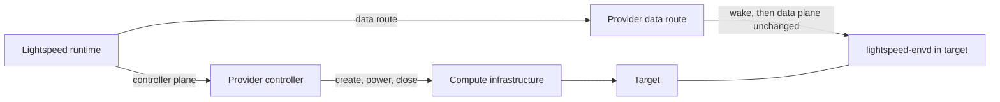

# Implement an environment provider

An environment provider supplies managed compute through Lightspeed's
environment protocol. Lightspeed asks it to create a target for an
environment and, later, to close it. Everything in between belongs to the
provider: power, idle policy, wake-up, ingress, placement, and any pools or
snapshots behind its targets. The provider also routes Lightspeed to the
daemon running inside each target.

The provider implements the controller plane of the
[environment protocol](../reference/environment-protocol.md). It does not need
Lightspeed's database, API implementation, harness, or Temporal runtime, and
it never calls Lightspeed. The included Incus provider demonstrates that
separation. If you only need to connect an existing machine,
[outbound daemon registration](../environments/bring-your-own-compute.md)
already provides that path without implementing a controller.

## Separate control from execution

The controller manages targets: VMs, containers, sandboxes, or other units of
compute owned by the provider. Inside each target runs `lightspeed-envd`, the
daemon that serves filesystem, transfer, process, and job operations. The
provider supplies compute and routing; it does not reimplement the daemon.
A target that exists in infrastructure is not necessarily ready to serve
data operations.



The two planes have separate version numbers. A provider speaks
`CONTROLLER_PROTOCOL_VERSION`; the daemon in its targets speaks
`ENVD_PROTOCOL_VERSION`. Both are matched exactly, and both are currently 4.
A provider that only relays data-plane messages does not parse them, but it
still calls the daemon's `env/getIdle` to run idle policy, so it moves with
the daemon's number. A provider that bakes the daemon into its images also
has to ship images whose daemon matches the runtime.

## Know what Lightspeed decides

Lightspeed keeps durable retries for only two decisions: create the target
until the provider accepts it, and close it until it is gone. It records
what the provider reports, for display, and never acts on that record to
move power.

| Concern | Lightspeed | Provider |
| --- | --- | --- |
| Create | Chooses the provider and template; retries `target/create` until accepted. | Creates the target, or hands one out from a pool. |
| Readiness | Proves the daemon answers with one data-plane handshake, then opens the environment. | Holds or refuses data route dials until the guest is up. |
| Power | Passes a user's manual change through to `target/setPower`. | Owns every transition, including its own idle policy. |
| Idle | Validates the template default or a create-time override and passes it through. | Runs the clock, escalates stages, and keeps busy targets awake. |
| Wake | Dials the data route, and waits when the dial is refused with a 503. | Resumes the target when its data route is dialed. |
| Ingress | Passes a user's change through to `ingress/ensure` or `ingress/remove`. | Realizes the edge, hostname, port, and TLS. |
| Close | Decides when; retries `target/close` until the target is gone. | Destroys the target; may also end targets on its own and report them closed. |

## Serve the controller endpoint

The controller is one WebSocket endpoint. The operator registers its URL in
Lightspeed. The URL may use `ws://`, `wss://`, or `unix:///absolute/path`,
under any path; the Incus provider uses `/control`. Use `wss` whenever the
controller is reachable beyond a single host.

A bearer credential is optional. When you configure one and the operator
registers the same value, every connection to the controller and to each
data route carries `Authorization: Bearer <credential>`. Compare it in
constant time and refuse a missing or wrong credential with HTTP 401 before
the WebSocket upgrade. Treat it as a secret in the provider's own
configuration, as the Incus provider does with its `credentialFile`. A
provider registered without a credential receives no `Authorization`
header; run it that way only where nothing but Lightspeed can reach it.

Run the shared JSON-RPC envelope and handshake on that socket. `initialize`
comes first, a repeat is `invalidRequest`, and another protocol version is
`versionMismatch`. The response names the `controller` plane and the
optional methods you serve:

```json
{
  "protocolVersion": 4,
  "plane": "controller",
  "serverInfo": {"name": "example-provider", "version": "1.2.0"},
  "capabilities": {"power": true, "ingress": false}
}
```

`power` serves `target/setPower`; `ingress` serves `ingress/ensure` and
`ingress/remove`. `template/list`, `target/create`, `target/get`, and
`target/close` are mandatory. Lightspeed reads `capabilities` on every
connection, never calls a method you do not advertise, and refuses the
corresponding API requests up front. If one arrives anyway, answer
`capabilityUnavailable`.

## Implement controller operations

| Method | Provider responsibility |
| --- | --- |
| `template/list` | Return the approved templates available to the supplied universe. |
| `target/create` | Return the owner's existing target, or apply template policy and start creating one. |
| `target/get` | Observe the target without changing anything. |
| `target/setPower` | Move the target to one of its template's power states, when you advertise `power`. |
| `target/close` | Destroy everything the owner's target holds, ingress included. |
| `ingress/ensure`, `ingress/remove` | Apply or remove provider-approved application exposure, when you advertise `ingress`. |

A create request carries the target's owner, a template selection, and
optionally a display name and an idle policy that replaces the template's
default:

```json
{
  "owner": {"universeId": "u1", "environmentId": "env_1"},
  "templateId": "ubuntu-24.04-small",
  "displayName": "build box",
  "idle": {"pauseAfterMs": 600000, "stopAfterMs": 3600000}
}
```

This comes from the protocol's
[create fixture](../../../crates/environment-protocol/fixtures/controller/target.create.json),
which also shows the response and a typed error. The request does not carry
an arbitrary image, private address, or cloud-init document. Your template
policy decides what the caller may provision. Validate `idle` with the
protocol's rules and answer `invalidParams` for one that breaks them.

Every target and ingress method answers `{"target": <observation>}`.
The [protocol reference](../reference/environment-protocol.md#controller-plane)
states each method's rules and errors.

### Answer promptly

Every method returns within a few seconds. Slow work, such as an image pull,
a boot, or a graceful shutdown, continues in the background. The runtime
follows it with `target/get`. Container and cloud APIs are usually
asynchronous already: answer `target/create` with `phase: provisioning` as
soon as the request is accepted, even before your backend has assigned an
id, and include `targetId` in the first observation that has one. A target
handed out from a warm pool can answer `active` at once.

### Make ownership survive retries

A target belongs to exactly one owner: a universe and an environment. You
hold at most one target per owner. An ambiguous infrastructure response is
normal: a create can succeed while its response is lost. `target/create` is
therefore idempotent per owner. When the owner already has a target, return
its observation and apply no creation policy, so deprecating a template
never affects existing targets.

Every target method names the owner in a target reference,
`{owner, targetId?}`. Without `targetId`, resolve the owner's target yourself.
This is how Lightspeed closes a target whose id it never learned, so
`target/close` must work by owner alone and answer `closed` without a
`targetId` when you hold nothing for that owner. A target that belongs to
another owner is `failedPrecondition` (`ownerMismatch`). Knowing a native
target id is never enough to reach or destroy a target.

The Incus provider derives deterministic names from the owner and records
`user.lightspeed.*` ownership metadata on its native resources, so it can
restart and reconcile without a private database. Another provider can use
labels, tags, or its own store, but must preserve the same properties.

### Report what you observe

An observation has two axes. `phase` is `provisioning`, `active`, `closing`,
`closed`, `failed`, or `unknown`. While `active`, `power` is `running`,
`paused`, `suspended`, or `stopped`, in provider-neutral terms: a paused
container and a frozen VM are both `paused`. Templates list in
`powerStates` only the states `target/setPower` can actually reach.

Report infrastructure observation, not the state a caller requested. An
observation does not say whether the daemon answers; Lightspeed proves that
itself by dialing the data route. When a target is `failed` or `unknown`,
or a transition waits for something, say why in `message`; Lightspeed shows
it to users with the environment.

Lightspeed reads each open environment's target every 5 minutes for
display. A target that is `failed` fails the environment. A target that no
longer exists is `notFound` from `target/get`, or `closed`; Lightspeed then
closes the environment as ended by the provider. So a target you removed on
your own, or one deleted out of band, is noticed within that interval.

### Close means destroy

`target/close` removes everything the owner's target holds, its public
ingress included. Stop gracefully within your own bound, then force. Answer
`closing` while that runs and `closed` once nothing remains. Repeated close
calls are expected and must observe the same outcome. Lightspeed never calls
`ingress/remove` before close; that method exists only to disable ingress on
a target that stays.

### Expose ingress through policy

Ingress follows provider policy. A request identifies an owned target; it does
not let callers choose ports or upstream addresses. A template advertises
`publicIngress`, and the provider decides the approved port and endpoint.
Report the realized endpoint in the observation's `ingress`, absent when
disabled. Lightspeed calls the ingress methods only when a user asks for a
change, and caches the endpoint you answer with. See
[Networking and ingress](../environments/networking-and-ingress.md) for the
user-facing behavior.

Templates report their size as typed `resources`: `vcpus`, `memoryBytes`,
and `diskBytes`. Use `metadata` only for display facts, such as an image
fingerprint.

### Return typed errors

Use the protocol's error kinds, each with its fixed integer code. Lightspeed
branches on them:

| Situation | Answer |
| --- | --- |
| Your backend API is unreachable or overloaded | `unavailable` or `busy`, optionally with `retryAfterMs`. The runtime retries. |
| The template is deprecated or the target's owner differs | `failedPrecondition` with `templateDeprecated` or `ownerMismatch`. |
| The template or target does not exist | `notFound`. |
| A power state is not in the template's `powerStates`, or an idle policy does not validate | `invalidParams`. |
| A power change on a target that is not active | `failedPrecondition` (`targetNotActive`). |

Retryable kinds, `internal`, transport failures, and timeouts are retried
with backoff, up to 5 minutes apart. An environment that has not opened
within 30 minutes of its creation fails with the last error. Other
refusals fail a provisioning environment at once, so reserve them for
requests that can never succeed. A refused manual power or ingress change
is returned to the user who asked for it; nothing retries it.

## Own power and idle policy

The provider owns power. Lightspeed calls `target/setPower` only when a user
presses a power button, and stores nothing but the observation you answer
with. Your own idle policy may move the target again at any time, and
Lightspeed does not undo it.

A template names a default idle policy in its `idle` field, and
`target/create` may carry an override for one target. Keep the policy a
target was created with: Lightspeed never sends a later change. A policy
stages `pauseAfterMs`, `suspendAfterMs`, `stopAfterMs`, and `closeAfterMs`,
non-decreasing in that order. For a running target, read the daemon's
`env/getIdle` over your own channel to the guest and apply the most
escalated stage whose threshold `idleForMs` has reached and whose power
state your template supports. The protocol crate's
[`IdlePolicy::due_action`](../../../crates/environment-protocol/src/idle.rs)
implements that rule. A powered-down target has no daemon to ask, so
continue its idle time on your own clock if later stages should still fire.

## Serve the data routes

A target's data route is your data route base followed by
`/{universeId}/{environmentId}/{targetId}`, each segment percent-encoded.
Lightspeed derives the base from your controller URL, its scheme, host and
port followed by `/routes`, unless the operator registers another one. Serve
the routes there, or tell operators which base to register; a `unix://`
controller always needs one registered. Lightspeed dials the route with the
credential when one is configured. Check that the owner in the path owns the
target, then connect the socket to the daemon in that target and relay
frames unchanged in both directions.

A dial is also the wake signal. When the target is paused, suspended, or
stopped, resume it, then try the daemon. Hold the dial for at most 5 seconds;
if the daemon answers in time, upgrade and relay. Otherwise refuse with a
typed JSON body that tells Lightspeed what to do:

| Situation | Answer |
| --- | --- |
| The target was powered down and is resuming | 503 `{"state": "waking"}` with `Retry-After` |
| The target runs, but the daemon does not answer yet | 503 `{"state": "booting"}` with `Retry-After` |
| No target exists for the owner, or it is closing | 410 `{"state": "gone"}` |
| The target is broken beyond recovery | 409 `{"state": "failed", "message": "..."}` |

`Retry-After` is in whole seconds, from 1 to 60. Lightspeed dials again
after it, and a tool call that needs the target keeps waiting meanwhile. A dial answered any other way is treated as an unreachable
provider.

A relay is an intermediary under the protocol's liveness rule:

- Forward ping and pong frames, and count every frame as activity.
- Never close a connection for idleness sooner than 60 seconds. A client
  waiting on a long read pings every 20 seconds and otherwise sends nothing.
- Accept and send WebSocket messages and frames of up to 16 MiB.

The data socket carries `secretEnv` values in plaintext. Use TLS or a
protected network on every hop, and keep those values out of logs, provider
metadata, and traces. The [credential guide](../environments/credentials.md)
describes the policy around them.

## Meet the provider obligations

Lightspeed cannot enforce what happens inside your infrastructure, so these
rules are part of the contract. Every provider:

1. makes `target/create` and `target/close` idempotent per owner;
2. wakes a powered-down target when its data route is dialed, holding the
   upgrade at most 5 seconds before it answers a typed refusal;
3. decides idleness from the daemon's `env/getIdle`, so running processes,
   jobs, and leftover process groups keep the target awake;
4. never powers a target down while it relays a data connection to it;
5. reports `closed`, or `notFound` from `target/get`, for a target it
   removed on its own, such as by a lifetime limit or an idle
   `closeAfterMs`;
6. never snapshots or clones a daemon state directory that holds a daemon
   identity.

A provider with no idle logic is valid, but it gives operators no cost
control: its targets stay up until someone closes them.

## Run the daemon in your targets

Install `lightspeed-envd` in every target and start it as a passive listener
the data route can reach, for example on a private port or a Unix socket.
Configure it with environment variables; the
[daemon reference](../reference/environment-variables.md#environment-daemon)
lists them.

- Set `LIGHTSPEED_ENVD_CWD` to the agent's working directory and, when the
  agent should see only part of the filesystem, `LIGHTSPEED_ENVD_FS_ROOT`.
- Set `LIGHTSPEED_ENVD_STATE_DIR` to a directory outside the working
  directory that survives the restarts you intend to support, such as
  `/var/lib/lightspeed-envd`. It holds job records and output, process spawn
  records, and the transfer journal. The daemon refuses every data-plane
  path inside it.
- Run the daemon as a user whose permissions fit the work. Commands run as
  that user, and the filesystem root is a boundary for data operations only,
  not for commands.

A passive daemon reached through your data route holds no registration
identity, so cloning a golden snapshot of such a target cannot duplicate a
daemon key.

The daemon reports a new `daemonInstanceId` after every start. Process
handles from an earlier instance answer `notFound` with reason
`daemonRestarted`, and unfinished jobs become `interrupted`. A container
runtime that restarts the daemon's process or replaces the container is
therefore visible to callers; avoid restarting a daemon that serves work.

`env/getIdle` reports how long the environment has been idle. Running
processes, running jobs, and process groups a command left running keep
`idleForMs` at zero; handshakes, idle reports, and discovery scans do not
count as use.

## Test the provider

Start with the protocol's fixtures and the conformance suites. They need
no Lightspeed deployment:

```bash
cargo test -p environment-protocol
cargo test -p environment-client
```

The controller suite in
[`environment_client::conformance::controller`](../../../crates/environment-client/src/conformance/controller.rs),
behind the client crate's `conformance` feature, drives your controller URL
with one template, and with your credential when you use one. It checks the
handshake rules, the HTTP 401 refusal, per-owner create idempotency, that
`target/get` never creates, owner fencing, close by owner and its
repetition, strict decoding of every observation, and
`capabilityUnavailable` for methods you do not advertise. It creates and
closes one target, so run it against a disposable account or project.
Lightspeed runs the same suite against its fake controller in CI, and the
Incus provider's live suite runs it against a real Incus server.

The data-route helpers in
[`environment_client::conformance::data_route`](../../../crates/environment-client/src/conformance/data_route.rs)
check a refused dial: a typed body, the status it names, `Retry-After` on a
503, and an answer within the hold bound. Point them at the data route of a
target you have just paused.

The data suite in
[`tools::environment_protocol::conformance`](../../../crates/tools/src/environment_protocol/conformance.rs)
drives a data endpoint through a data client. Point it at one of your
targets through your data route to verify that the relay passes the daemon's
behavior through: writes and reads, confinement, walks, process output and
exits, and job identity. It works in a fresh directory and removes it.

The suites do not cover everything. Also exercise ambiguous create retries,
cross-universe access, daemon startup lag, wake on dial from every power
state you support, an idle policy that pauses and later stops a quiet target,
a busy target that stays awake, relay idle behavior during a quiet long read,
a close of a target whose create failed midway, and ingress teardown.

## Register and verify it in Lightspeed

Register the provider through `deployment/environment-providers/put` with its
controller endpoint and, when you use one, its credential. A data route base
is optional unless the controller URL is `unix://`, or Lightspeed reaches
your data routes under another address. The credential is write-only: kept
when omitted, removed with `clearCredential`, and never returned.
Registration runs the controller handshake. A refused upgrade, such as HTTP
404 for a wrong path or 401 for a wrong credential, another plane, or a
configured data route base that downgrades a `wss` controller, refuses the
registration. A controller that cannot be reached yet is accepted.

Create an enabled universe binding and inspect the templates. The
[Incus setup guide](../environments/incus-vms.md) shows the registration and
binding procedure; use your provider's controller URL, credential, and
templates.

Create an environment, wait for it to open, read and write a disposable
file, and run a harmless command. Exercise each advertised power state, let
the idle policy power the target down, wake it with a tool call, and close
it. Confirm that the infrastructure target and any ingress are actually
removed.

| Symptom | What to inspect |
| --- | --- |
| Provider registration is refused | Controller URL path, credential, plane, and that a configured data route base uses `wss` for a `wss` controller. |
| The target runs but the environment never opens | The daemon's startup, the data route base, and the data route's reachability from the environment gateway. The environment's state message names the last problem. |
| The environment fails with a version message | The daemon in your image speaks another protocol version than the runtime. Rebuild the image. |
| An environment stays provisioning with a state message | Transient controller errors are being retried; the message names the last failure. |
| Retrying create allocates another target | Ownership is not resolved before creation policy runs. |
| A tool call waits and then fails while the target sleeps | The data route does not wake the target, or never upgrades after waking. |
| A target sleeps while a command runs | The idle loop does not use `env/getIdle`, or acts while a data connection is relayed. |
| Long reads fail after about a minute | A relay closes quiet connections or drops pings. |
| A closed target still has public access | `target/close` did not remove ingress with the target. |
