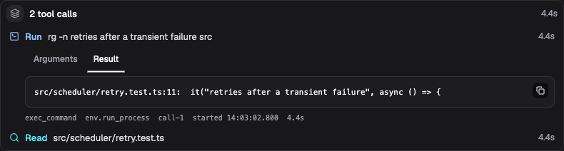

# Sessions and runs

A session holds an agent's conversation and setup. A run is one attempt to
carry out a task in that session: it can contain several model turns and tool
calls before the agent finishes, fails, or is canceled. Sending another task
starts another run with the conversation that came before it.

This distinction gives you two kinds of control. You can ask for more work
after the current task, or change what the agent is doing now. The session
retains both the work and its history when you leave the page.

Use a Contributor, Operator or Admin account in the universe for the web
procedures below. To control an existing private session, you must be its
creator or an Admin; shared sessions can be controlled by Contributors and
above. Changing session setup or per-message model and reasoning options
requires an Operator or Admin. If you haven't completed a task yet, start with
[Build your first agent](../getting-started/first-agent.md).

## Start and continue a session

Open **Sessions → New session**, enter a **Name**, and select an existing
**Profile** or **No profile (universe default)**. Choose **Create**. The profile
is resolved at creation; later profile edits do not change this session.
Contributors use these prepared choices without configuration overrides.

Operators and Admins can choose **Customize setup…** to change the setup for
this session without saving those changes back to the profile. After
customizing, choose **Create session**. They can also customize a session
that starts without a profile.

Send a task in the composer. For the release editor from the first-agent
walkthrough, try:

```text
Read /workspace/changes.md and /workspace/release-notes.md.
Check every release-note claim against the change list.
Report any mismatch, but leave the files unchanged.
```

When the answer arrives, send a follow-up in the same session. The agent can
use the earlier conversation and its linked files. Starting a new session
from the same profile gives you a fresh conversation; workspace attachments may
still point to the same shared files.


## Share a session with the universe

New standalone sessions are private: through the Platform, only their creator
and Admins can read them. To share a review with the team, open the session
title menu, choose **Share with universe…**, and confirm with **Share**. This
also shares its sub-agents. Sharing cannot be undone.

Every member can then read the conversation, and Contributors and above can
continue runs, steer, cancel work, or decide tool approvals. Sharing requires
the creator with at least the Contributor role, or an Admin. Bot conversations
are always shared; delegated sessions follow their root's visibility.

Files written into an attached shared workspace remain visible through that
workspace even while the conversation is private. Direct core keys with the
`session` method group also have access to private sessions in their universe.
See [Private and shared work](../access-and-security/private-and-shared-work.md)
for the access model.

## Queue, steer, or stop work

Only one run is active in a session at a time. The composer changes its
behavior while that run is working:

| Action | Effect |
| --- | --- |
| Send while idle | Starts a run. |
| Send while a run is active | Queues a separate run after the current work. Queued runs execute in order. |
| **Cmd+Enter** on macOS, **Ctrl+Enter** elsewhere | Steers the active run with an additional instruction. |
| **Shift+Enter** | Adds a newline in the composer. |
| **Stop run** | Requests cancellation of the active run. |
| Cancel an item in the queued-runs bar | Removes that queued task without stopping the active one. |

Suppose the release editor is checking a long document. Queue
“After this, write a short summary” when that is a second task. Steer with
“Focus the current review on compatibility claims” when you want to change
the review already in progress.

Steering reaches the agent at its next model turn. It does not interrupt a
model response or tool call already executing. If the run is waiting for a
promise, steering waits with it; it does not wake the run by itself.

Cancellation stops further work and requests cancellation of active model and
tool activities. It does not undo effects that have already happened, such as
a saved file or a message sent by a tool. Wait for the run to reach its
canceled state before treating it as stopped. Other queued runs remain queued
and can start afterward, so cancel them separately if you want the session to
remain idle.

For environment commands, cancellation terminates a command that has not yet
returned a handle. One that already yielded keeps running until it is stopped or the
environment closes. Inspect and stop that process explicitly as described in
[Processes and jobs](../environments/processes-and-jobs.md#collect-output-and-stop-a-process).

Some tools pause for approval. Review their arguments and choose **Approve**
or **Reject** for each pending call. The run continues once every pending
decision has been made. Calls already running beside a gated call finish first, and
calls later in that batch wait for the decision. See
[Tools and MCP](tools-and-mcp.md) for configuring that policy.

## When a run fails

A failed run reports its kind and the real message, and the session stays open, so
you can send the next task. The kinds are:

| Kind | What happened |
| --- | --- |
| `contextFailure` | The context would not fit and could not be compacted, or the session is at its [entry limit](#manage-long-conversations). |
| `modelFailure` | The provider failed, or its response could not be read, after the retries a transient failure gets. |
| `requestRejected` | The provider refused the request, for example a parameter this model does not accept. |
| `outputTruncated` | The answer was cut off by the provider's output limit. |
| `contentFiltered` | The provider refused the response. |
| `limitExceeded` | The run needed another turn past **Max turns**. |
| `internal` | Lightspeed refused something it should not have reached. Worth reporting. |

**Max turns** under the model setup's run controls limits the turns a run may start. It
is unset by default, so a run can take as long as it needs. A set limit counts every
turn, including recovery turns and turns delivering steering.

## If a session's workflow stops

A banner saying the session's workflow has stopped means its history is intact but
nothing is running it, so new messages fail. An Operator or Admin can choose
**Restart**. A run that was in progress fails, with a message saying so, rather than
repeat work it may already have done. A run waiting on an approval or a result keeps
waiting, and queued runs start afterwards. See
[Restart a stopped session](../deployment/upgrades-and-recovery.md#restart-a-stopped-session)
for what a restart cannot recover.

## Inspect what happened

The transcript shows messages and tool activity. Each tool row names the
operation, its target, and how long it took. Open a row to inspect its
**Arguments**, **Result**, **Error**, and any reported **Effects**. For example,
after the agent says it saved a file, inspect the write result and open the
file to verify the change.

Images and documents appear as thumbnails and document links beside the
message or tool result that supplied them. Click one to open it at full size.
The agent can also reference those items inline in its answer.

When a run finishes, its thinking, tool calls, and interim notes fold behind
one strip that names the outcome and number of tool calls; the final reply
stays visible below it. Click the strip to open the run, or turn off
**Collapse completed runs** in the session title menu to keep runs open.
Events delivered to a bot appear as bands headed by their sender and kind.



*Demo mode: an expanded tool call in “Fix flaky scheduler test.” The result
shows what the command found; **Arguments** shows the submitted request.*

Click a finished run's context and usage figures for a breakdown, or hide them
with **Show run statistics** in the session title menu. Context describes the
last model request; cumulative tokens describe the whole run. A missing
measurement means it was unavailable.

Long conversations load a recent window first. Scroll upward to load older
history. Context compaction can reduce what the model carries into future
calls while leaving the retained transcript available to inspect. It does
not mean that the agent will reproduce every earlier detail from memory; keep
important source material in files it can read again.

## Manage long conversations

New sessions use automatic standalone compaction by default. It reduces older
conversation at safe boundaries between model turns while a run is active, and at
the start of a new run. An idle session stays as it is, so your next message can wait
behind a compaction. When input capacity is known, the default trigger is 80% of that
capacity; otherwise Lightspeed can recover when the provider reports a full context
window. Recovery resumes the same run with completed tool results retained.
It can still fail when the protected input is too large or its bounded
attempts cannot make enough room. The failure then names the largest entry, so you
can [replace it](cli.md#repair-rejected-context) or start a new session. After a
failed attempt, automatic compaction waits for the context to grow by about 10%
before trying again.

Compaction also runs at 1,500 active context entries, whatever the token count, on any
enabled setting. At 2,000 entries a run makes one more attempt and fails if the count
stays over, because a session much larger than that can no longer load. A session with
compaction **Disabled** fails each run at that point. Enable compaction or request one
to continue.

A message that could never fit is refused when you send it, if the limit is known,
rather than failing every run after it.

As an Operator or Admin, open **Customize run controls → Context compaction**
in the profile or idle session's model setup. **Engine default** and **Engine managed standalone**
enable standalone compaction; **Provider triggered** uses supported OpenAI
Responses or Anthropic Messages generation compaction. **Disabled** turns off
automatic compaction and recovery. **Input limit tokens** overrides usable
input capacity; leave it blank to use reported capacity or error-driven recovery.
Session settings show the effective mode, threshold, queued or pending state,
and recovery attempts.

An API caller can request one `session/context/compact` operation in any mode;
active work queues it until a safe boundary.

Compaction can summarize away details, so keep important source material in
workspaces. It preserves retained history and original blobs. The
[context guide](../how-it-works/context-and-storage.md#compact-the-active-conversation)
explains provider behavior and protected input. For a specific rejected entry,
use [context repair](cli.md#repair-rejected-context) instead.

## Dictate a message

With a [speech-to-text default](models-and-credentials.md#configure-speech-to-text)
configured, choose the composer's microphone (**Dictate message**) and allow
microphone access. Choose **Stop recording** to transcribe and insert the text
into your draft. Review or edit it, then send normally. Recording stops
automatically after ten minutes; dictation audio is limited to 25 MiB.

You can keep editing while transcription runs. Recording or stopping alone
does not start a run. If you choose **Send** or press **Enter** while recording
or transcribing, the composer waits for the transcript and then submits the
message. During an active run, that action queues the next run; choosing
steering instead sends it to the active run when ready.

**Cancel dictation** or **Esc** discards the recording or pending transcription
and clears any send waiting for it. Failures preserve your existing draft;
use **Retry transcription** when available. The microphone control explains
unavailable recording or model configuration. Browsers require microphone
permission and a secure origin, such as HTTPS or localhost.

## Find and change a session

Open **Filter sessions** in the session list. Under **Include**, select
**Closed sessions**, **Sub-agent sessions**, or **Managed sessions** to show
those conversations. **Metadata filters** accept `key=value` pairs, and
**Metadata keys to show** adds useful values to the list.

Metadata is a descriptive map, for example `project=acorn` and
`purpose=release-review`. It does not grant access or instruct the model.
Open **Session settings** to inspect metadata, custom instructions, model
configuration, and attached resources. Viewers and Contributors see a read-only
form: sections still expand, but values cannot be changed and **Apply setup**
is hidden.

Operators and Admins can edit the setup and choose **Apply setup**. Changes to
the agent's working setup require an open session with no active or queued
runs. The composer's per-message model and reasoning choices, including saving
a model choice as the session default, also require an Operator or Admin.

A session keeps its configured provider identity and API kind for its entire
lifetime, including before its first run. You can switch to any model within
that route, such as between OpenAI models, and switch back later. Changing
provider or API kind requires a new session because conversation context may
contain provider-native opaque data. If a provider refuses a particular switch, the
run fails with its message and the session stays open, so you can switch back. An
aggregator such as OpenRouter counts as one configured provider; the underlying
vendor name alone does not determine compatibility.

Existing ordinary sessions keep the setup they received at creation. Editing
their source profile does not update them automatically. See
[Profiles and instructions](profiles-and-instructions.md) for explicit profile
application and the different behavior of bot conversations.

To start a fresh conversation with the same setup, create another session
from the same profile.

## Continue from the CLI

For saved connections, `connect dev`, terminal-only provider setup and universe
switching, see [Use Lightspeed from the terminal](cli.md).

The CLI can open the same session as the web app. On Linux x86_64,
[download the prebuilt CLI](../deployment/self-hosting.md#download-standalone-binaries)
from the release matching your server. You can also build it from the repository:

```bash
cargo build --locked -p cli
```

The examples use `lightspeed` on your executable path. Use `./lightspeed`
for a release binary in the current directory, or `target/debug/lightspeed`
for the source build above.

For the authenticated development launcher stack from the quickstart, use its
runtime gateway and a universe API key created by an Admin. See
[API keys and service access](../access-and-security/api-keys-and-service-access.md)
for creating and revoking keys. A universe key already selects its universe:

```bash
export LIGHTSPEED_API_URL=http://127.0.0.1:18080/rpc
export LIGHTSPEED_API_KEY="<universe API key>"
unset LIGHTSPEED_UNIVERSE
lightspeed chat --session "<session-id>"
```

Copy **Session ID** from the web app's session title menu.
For a remote installation, use the gateway address and authentication supplied
by the operator. A deployment key needs `LIGHTSPEED_UNIVERSE` set to the core
universe UUID, distinct from the readable slug in the browser URL. Local
single mode accepts neither API keys nor universe headers.

Without model flags, `lightspeed chat` uses the deployment default for a new
session and the stored model when opening an existing session. To choose a
route for a new session, supply `--provider`, `--api-kind`, and `--model`
together. When reopening a session, these flags may select another model
only within that session's existing provider and API kind.

Inside the terminal interface, `/model` selects a model for subsequent runs;
`/provider` shows discovery but cannot change the session's provider. Switching
sessions with `/sessions` discards the previous session's model override and
uses the selected session's stored model. `/refresh` retries failed transcript
reads; incomplete transcripts are reported as errors, including in one-shot
and JSON output.

Inside the terminal interface, `/help` lists commands. `/steer` sends an
instruction to the active run, and `/approve` or `/reject` decides a pending
approval by ID. `/interrupt` cancels the newest queued run first, or the active
run when no queued run exists. `/quit` exits the interface and leaves the
session available to reopen.

At startup, the TUI header shows the full session ID, universe and key scope,
then the runtime endpoint and useful slash commands. Model and effort remain
in the footer; `lightspeed --version` shows the build version.
The TUI shows live tool activity as calls run and finish, including individual
running, done, failed and cancelled states. An animated thinking/working
indicator stays below the latest tool activity, just above the composer.
Live and completed tools use the same compact layout; `--show-tool-details`
adds arguments and results. Execution-group numbers are not displayed. Session refreshes preserve
observed tool activity while the model continues; completed run details provide
the final transcript. Following a run also leaves chat commands available, and
opening an already-active session resumes live updates.

Run statistics (timing, token/cache usage, call counts and context details)
are hidden by default. Start with `lightspeed chat --show-stats` to show
them, or use `/stats` inside chat to toggle them. `/stats on` and
`/stats off` set visibility explicitly, including statistics already in the
transcript. This preference lasts for the current chat process. The flag also
applies to one-shot text output; JSON output retains all run data.

Applications can use `session/runs/start`, `session/runs/read`,
`session/runs/steer`, and `session/runs/cancel` from the
[API reference](../../../crates/api/contract/api-reference.md). Starting a run
acknowledges admission; follow its state and events to obtain the final result.
Use a stable `submissionId` when retrying the same submission. A call that answers
`operationPending` was held, usually behind a compaction, and can still land, so retry
it with the same ID rather than a new one.

## Close and retain a session

Leaving a browser tab or quitting the CLI has no effect on session lifecycle.
**Close session** is a separate, permanent action: a closed session cannot
accept more work or be reopened. Its retained history is still inspectable.
**Force close session** also cancels outstanding work, including queued runs.
A session whose setup fails when you create it leaves nothing live: an ID the server
chose is closed, and retrying an ID you chose reports the error again.

Deleting a closed session in Platform **soft-deletes** it: it disappears from
ordinary session views for everyone, including Admins, while its history remains stored.
**Also delete delegated children** includes its retention descendants, which must
also be closed. Without that option, the session must have no retention descendants.
Closing and deletion have different [role requirements](../access-and-security/private-and-shared-work.md#what-each-person-may-do).

Admins can set **Delete after close (days)** to automatically soft-delete a
closed session tree; a blank value keeps it until manual deletion. The root
owns this policy for its retention tree, and deletion waits until all descendants
are closed. This policy never permanently removes stored history. Bot conversations
are kept until deleted, whatever their profile sets.

Within Platform, only Platform admins can permanently delete retained session
history. In the delete dialog, select **Also permanently delete retained history** to soft-delete
and then purge. For already deleted sessions, open **Platform admin → Universes →
Deleted sessions**, select sessions and choose **Purge selected…**, or use
**Purge all…**, then confirm removal of their deleted history trees. There is
no automatic purge or restore action.
Permanent deletion through Platform is recorded in the
[audit log](../access-and-security/overview.md#what-is-recorded-today).

Direct runtime clients use `session/delete`, which permanently deletes by
default; pass `softDelete: true` to retain hidden history. Similarly,
`lightspeed session delete` deletes permanently unless `--soft-delete` is set.
Both modes require closed sessions and use `cascade` for retention descendants.
Platform always requests soft deletion before its separate admin purge step;
automatic retention also continues to soft-delete only.

Bot and channel conversations have a lifecycle controller. Their session
inspector identifies what manages them; use that controller's reset or close
actions. If you enable direct input in a managed-session inspector, you bypass
the controller's normal event admission, routing, and delivery policies. Use
the [bot conversation](bots-and-triggers.md) or connected chat for normal work.

## If a session behaves unexpectedly

| Symptom | What to check |
| --- | --- |
| A message is waiting while the agent works | It may be a queued run. Use steering for an instruction intended for the current task. |
| Steering has no immediate visible effect | The current model call or tool batch must finish before the next model turn can consume it. |
| Work starts again after stopping | Check for other queued runs. Stopping one run leaves those tasks in place. |
| Setup changes are refused | Confirm you have an Operator or Admin role. Wait for active work to finish and drain or cancel queued runs. Reload settings if another editor changed them. |
| A finished child or closed conversation is missing | Under **Filter sessions → Include**, select **Closed sessions** and **Sub-agent sessions**, or follow the child link from the parent transcript. |
| The agent lost a detail from much earlier | Inspect the retained history and restate the needed fact or point it to the source file. The current model context can be smaller than the transcript. |
| A banner says the workflow has stopped | [Restart the session](#if-a-sessions-workflow-stops) if you want to continue it. |
| A run fails with a message about too many context entries | Enable compaction or request one. The session is at its [entry limit](#manage-long-conversations). |
| Your first message after a long idle takes a while to start | The session may be compacting before the run. |
