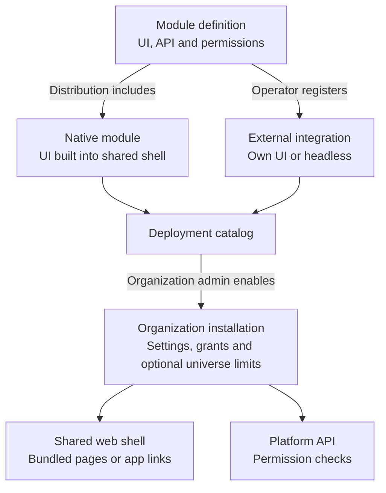
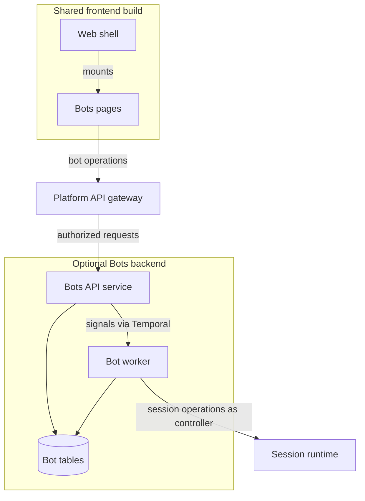
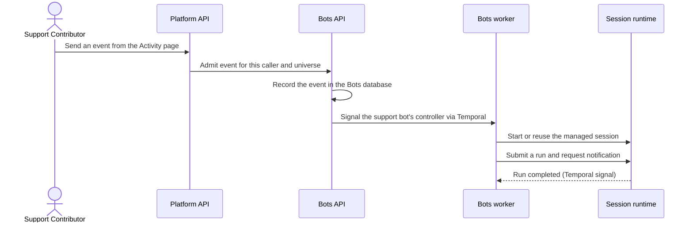
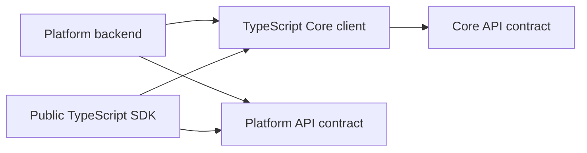

# Platform modules on a shared Lightspeed deployment

**Status** — Proposed for review.

A **module** adds a feature to Lightspeed. For example, the Bots module provides the pages for managing bots and the worker that handles bot events. Platform core defines the interfaces for this plugin system. Each Lightspeed distribution chooses which modules to include, so the same core can run with or without Bots.

An organization can enable the modules it needs on a shared deployment. Its universes remain the boundaries for sessions, credentials, and other resources.

## How teams contribute and ship

| Contribution | What the user sees | How an update ships |
| --- | --- | --- |
| **Native Platform module** | Pages, settings, or actions integrated into the shared shell. | When one team updates its UI package, CI tests it with the shell. That change can ship on its own in the next shared frontend deployment. |
| **External integration** | A link to a separately hosted application, or a headless service that uses the Platform APIs. | The integration team deploys its own UI and services on its own schedule. It calls Lightspeed with scoped credentials. |

The distribution selects native UI packages at build time. At run time, configuration can activate a bundled page or supply something the shell already knows how to render, such as a navigation link. A team that needs a new React component inside the shell contributes it to a native package. Its backend can still ship independently as long as its API stays compatible. Independently loaded transcript extensions would be a separate design. These choices apply equally to open-source, proprietary, and client-built features.

## How a module becomes available to a team

The deployment operator decides which modules to offer each organization. An Organization Admin enables a module once. If it provides features in universes, all current and future universes in the organization inherit that choice by default. The admin can limit it to selected universes when needed. A module that works entirely at organization scope can contribute an organization page directly.



## What stays in core

The **runtime** owns sessions, runs, durable state, and tool execution. Modules use its published session API and managed-workflow and workflow-tool protocols. Runtime capabilities such as VFS and web search can have deployment limits that a universe or session may narrow. The runtime enforces those limits. [Session and workflow contracts](../../documentation/integrating-and-extending/workflow-tools.md)

**Platform core** owns identity, organizations, universes, permissions, module availability, and the public API entry point. Its web shell provides navigation and a place to mount pages. The standard Sessions UI should use the same page interface available to module authors. The session API also works in a distribution that omits the Sessions page.

## A concrete example with Bots

Suppose Acme enables Bots for its support universe. A Contributor opens **Bots → Support triage → Activity** and sends the bot an event. The page, the public bot operations, and the process that does the work all belong to the Bots team. They ship in different places.



The **Bots UI package** contributes the `/u/:handle/bots` routes and their navigation entry. The **Bots API service** implements operations such as `bots/events/admit`, available to the browser and CLI through the same gateway. A UI-only endpoint can compose data for a screen under the same authorization rules. The **Bots worker** runs the controller and trigger workflows. A change to the Activity page ships with the shell. A compatible fix to how the worker handles a trigger can ship with the worker alone.

Bots owns its records, triggers, events, and database migrations. It could use a separate database or a schema in the shared PostgreSQL instance, where the module's database role determines which tables it can access. A deployment that omits the entire module should still be able to run sessions and collect unused blobs. Today, core session access queries and blob collection both reference bot tables. Their replacements must preserve session visibility and retain blobs that bot events still use. [Session access](../../../crates/store-pg/src/access.rs) · [Blob collection](../../../crates/store-pg/src/cas_sweep.rs)

A deployment operator trusts the native code they install. Platform still checks that Acme's installation covers the support universe, that the Contributor holds `invokeBot` there, and that any API key permits the call. The worker subsequently acts as the support bot. It calls the session runtime directly under that controller's authority. Today's worker supplies that identity in-process. Across a process boundary the call would carry the same authority over an authenticated connection. [Bot permissions](../../../platform/backend/src/routes/method-actions.ts) · [Bot worker](../../../crates/temporal-runtime/src/worker/bots.rs) · [Controller authority](../../../crates/temporal-runtime/src/gateway/service/controller.rs)



## How configuration could read

These YAML excerpts illustrate three decisions. The field names are proposals for discussion.

**1. The publisher describes what the module contributes.** This excerpt declares the actions Platform checks before forwarding two bot operations. Under the current role mapping, a Contributor can send an event, while editing a trigger requires Operator or Owner.

```yaml
id: bots
operations:
  bots/events/admit: { action: invokeBot }
  bots/triggers/put: { action: manageBot }
```

**2. The distribution selects native pages. The deployment operator makes services available.** The first section is input to the frontend build. The second registers endpoints for the running deployment. Acme's approvals link opens the client's own UI.

```yaml
distribution:
  nativePages: [sessions, bots]
deployment:
  modules:
    bots:
      service: http://bots.internal
    acme.approvals:
      appUrl: https://approvals.acme.example
      organizations: [acme]
```

**3. Acme's admin enables modules for the organization.** Approvals is available across Acme. The admin limits Bots to the support universe, where the team can configure individual bots, triggers, and credentials. A newly created research universe inherits Approvals automatically.

```yaml
kind: organization
handle: acme
modules:
  acme.approvals: { enabled: true }
  bots: { enabled: true, universes: [support] }
```

Today, a universe Owner switches Bots on, and switching it off governs member access while scheduled work can continue. Adopting organization installations should preserve those existing universe choices. Suspending automation and deleting a universe's bot data also need explicit lifecycle behavior. [Current Bots switch and lifecycle](../../documentation/using-lightspeed/bots-and-triggers.md)

## Proposed project structure

Lightspeed stays in one repository. **Core** is the Rust subproject that builds the `lightspeed-runtime` executable. **Platform** hosts the application and its plugins. The standard distribution selects which plugins ship with the shell.

```text
core/
  Cargo.toml                 Rust workspace for Core
  Cargo.lock
  crates/
    api/                     Public Core API contract
    …                        Session engine, workflows, storage, runtime adapters

platform/
  web/                       Shared shell and standard frontend assembly
    src/plugins.ts           Registers the distribution's bundled pages and navigation
  backend/                   Authentication, permissions, and API gateway
    src/plugin-routes.ts     Registers plugin API routes with the gateway
  db/                        Platform-owned records and migrations
  shared/                    Platform API contract and plugin registration types
  plugins/
    sessions/                Built-in Sessions UI
    bots/
      module.yaml            Plugin ID and public operations with their required actions
      web/                   Bot pages, settings, and navigation
      server/                Bot API, worker, tables, and migrations

clients/
  cli/                       Lightspeed command-line client
  python/                    Public Python SDK
  typescript/
    core-client/             Typed calls to the Core API
    sdk/                     Public @lightspeed-ai/sdk package

environments/                Environment daemon and standalone providers
```

**Where plugins are registered.** The proposed layout gives each host an entry point.

- **Frontend.** `platform/web/src/plugins.ts` imports the UI contributions selected for the distribution, such as the pages exported by `platform/plugins/bots/web/`. The shell uses that list to build its router and navigation. The frontend build determines which components it can render. At sign-in or when switching organizations, the shell uses availability and permission data from Platform to show the relevant entries.
- **API.** At startup, `platform/backend/src/plugin-routes.ts` pairs each registered plugin's operation descriptors with its configured service endpoint and mounts the routes under `/api/v1`. On each request the gateway checks the installation, target scope, and caller's permissions before forwarding to the service. For example, the Bots descriptor declares `bots/events/admit` and its `invokeBot` action. The gateway routes the authorized request to the Bots service, which owns the handler.

Both entry points use the same plugin ID. Enabling Bots for an organization changes which registered features its members can use. The frontend bundle and the running Bots service can serve multiple organizations.

The TypeScript Core client lives under `clients/` because both Platform and the public SDK use it. Core owns the session and run contract. Platform owns the contract for operations such as managing organizations. The arrows show build dependencies, including contracts used to generate bindings.



Application developers install `@lightspeed-ai/sdk` and point it at Platform. The Platform backend uses the smaller Core client with its private runtime endpoint and credential. Plugins use Platform's registration interface to contribute pages and routes. A worker can use the Core API through bindings for its own language.

Core has its own build and CI job. A change to the Bots page can test the plugin and shell together and release the shared frontend. A Core API change also triggers checks for the clients and plugins that consume the affected contract.
