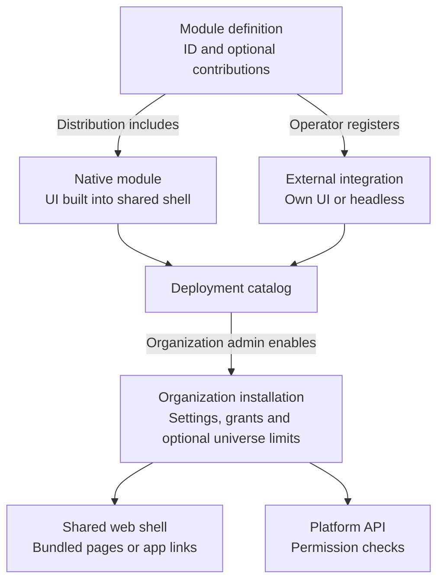
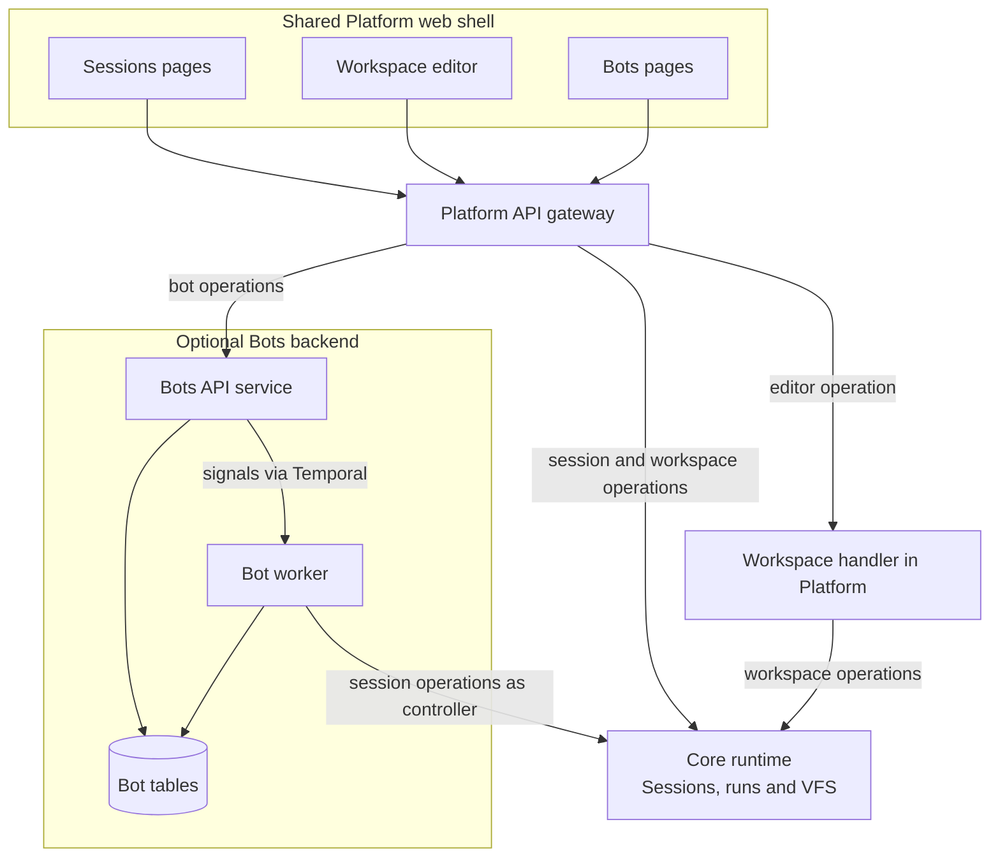
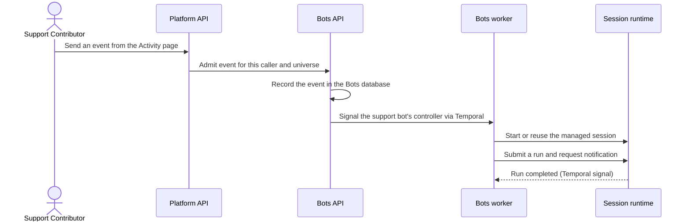
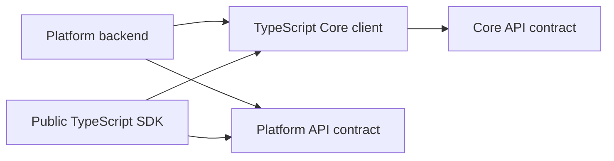

# Platform modules on a shared Lightspeed deployment

**Status** — Proposed for review.

Lightspeed teams contribute product features as **modules**. The Sessions module adds pages for sessions the Rust runtime already manages. The Bots module owns the whole feature, from its pages and API to its worker and database tables. They use the same plugin system. Platform defines how modules register pages and operations, and each distribution selects the modules it includes.

An organization can enable the modules it needs on a shared deployment. Its universes remain the boundaries for sessions, credentials, and other resources.

## How teams contribute and ship

| Contribution | What the user sees | How an update ships |
| --- | --- | --- |
| **Native Platform module** | Pages, settings, or actions integrated into the shared shell. | When one team updates its UI package, CI tests it with the shell. That change can ship on its own in the next shared frontend deployment. |
| **External integration** | A link to a separately hosted application, or a headless service that uses the Platform APIs. | The integration team deploys its own UI and services on its own schedule. It calls Lightspeed with scoped credentials. |

The distribution selects native UI packages at build time. At run time, configuration can activate a bundled page or supply something the shell already knows how to render, such as a navigation link. A team that needs a new React component inside the shell contributes it to a native package. Its backend can still ship independently as long as its API stays compatible. Independently loaded transcript extensions would be a separate design. These choices apply equally to open-source, proprietary, and client-built features.

## How a module becomes available to a team

The deployment operator decides which modules to offer each organization. An Organization Admin enables a module once. If it provides features in universes, all current and future universes in the organization inherit that choice by default. The admin can limit it to selected universes when needed. A module that works entirely at organization scope can contribute an organization page directly.



## What stays in core

The **runtime** owns sessions, runs, durable state, and tool execution. Modules use its published session API and managed-workflow and workflow-tool protocols. Runtime capabilities such as VFS and web search can have deployment limits that a universe or session may narrow. The runtime enforces those limits. [Session and workflow contracts](../../documentation/integrating-and-extending/workflow-tools.md)

**Platform** owns identity, organizations, universes, permissions, module availability, and the public API entry point. Its web shell provides navigation and a place to mount pages. The shell and gateway serve every organization in the deployment.

## How Sessions, Workspaces, and Bots use the same module system

| Module | What the module owns | How a request runs |
| --- | --- | --- |
| **Sessions** | Session list, transcript, and run controls. | The pages use the existing session API through Platform. Other clients can still start sessions when the distribution omits these pages. |
| **Workspaces** | The file browser and editor for VFS. It can also contribute a handler to the Platform backend if an editor action needs server-side logic. | Platform authorizes the request. The handler can compose Core workspace operations, and Core owns the snapshots and blobs. |
| **Bots** | Bot pages, public operations, records and migrations, and a Temporal worker for controllers and triggers. | Platform authorizes a bot operation and forwards it to the Bots API. The bot worker drives sessions through Core's managed-session protocol. |



An organization can disable the Workspaces module while its agents still use VFS. To disable VFS execution for a deployment, the operator sets a Core capability limit. Enabling Bots for a second organization lets its authorized members use the Bots service and worker already running in the deployment.

## A concrete example with Bots

Suppose Acme enables Bots for its support universe. A Contributor opens **Bots → Support triage → Activity** and sends the bot an event. The page, the public bot operations, and the process that does the work all belong to the Bots team. They ship in different places.

The **Bots UI package** contributes the `/u/:handle/bots` routes and their navigation entry. The **Bots API service** implements operations such as `bots/events/admit`, available to the browser and CLI through the same gateway. A UI-only endpoint can compose data for a screen under the same authorization rules. The **Bots worker** runs the controller and trigger workflows. A change to the Activity page ships with the shell. A compatible fix to how the worker handles a trigger can ship with the worker alone.

Bots owns its records, triggers, events, and database migrations. It could use a separate database or a schema in the shared PostgreSQL instance, where the module's database role determines which tables it can access. A deployment that omits the entire module should still be able to run sessions and collect unused blobs. Today, core session access queries and blob collection both reference bot tables. Their replacements must preserve session visibility and retain blobs that bot events still use. [Session access](../../../crates/store-pg/src/access.rs) · [Blob collection](../../../crates/store-pg/src/cas_sweep.rs)

A deployment operator trusts the native code they install. Platform still checks that Acme's installation covers the support universe, that the Contributor holds `invokeBot` there, and that any API key permits the call. The worker subsequently acts as the support bot. It calls the session runtime directly under that controller's authority. Today's worker supplies that identity in-process. Across a process boundary the call would carry the same authority over an authenticated connection. [Bot permissions](../../../platform/backend/src/routes/method-actions.ts) · [Bot worker](../../../crates/temporal-runtime/src/worker/bots.rs) · [Controller authority](../../../crates/temporal-runtime/src/gateway/service/controller.rs)



## Open question about shared design and product language

When a module introduces a concept that users encounter elsewhere in Lightspeed, who owns its design and wording? For example, someone following an event from Bots into a session should be able to recognize which bot started it. The Bots activity page and the session header might both show “Started by Support triage” with a link to the bot. Who owns that interaction, its visual treatment, and the label and its translations?

Should the Bots team implement it in the module and contribute it wherever the shell supports it? Should the shared design system and shell own a general way to show who started a session, with Bots supplying the name and destination? If a pattern starts in a module, when should the team bring it upstream for other features to use? The design needs to work both for someone moving between Bots and Sessions and for a deployment that ships Sessions on its own.

## How configuration could read

These YAML excerpts illustrate three decisions. The field names are proposals for discussion.

**1. The publisher describes what the module contributes.** This excerpt declares the actions Platform checks before forwarding two bot operations. Under the current role mapping, a Contributor can send an event, while editing a trigger requires Operator or Owner.

```yaml
id: bots
operations:
  bots/events/admit: { action: invokeBot }
  bots/triggers/put: { action: manageBot }
```

**2. The distribution selects native modules. The deployment operator makes services available.** The distribution's list selects the web and API contributions for the shared application. Sessions contributes pages alone. Bots also contributes operations, so the operator supplies its service endpoint. Acme's approvals link opens the client's own UI.

```yaml
distribution:
  nativeModules: [sessions, workspaces, bots]
deployment:
  modules:
    bots:
      service: http://bots.internal
    acme.approvals:
      appUrl: https://approvals.acme.example
      organizations: [acme]
```

**3. Acme's admin enables modules for the organization.** Approvals is available across Acme. The admin limits Bots to the support universe, where the team can configure individual bots, triggers, and credentials. A newly created research universe inherits Approvals automatically.

```yaml
kind: organization
handle: acme
modules:
  acme.approvals: { enabled: true }
  bots: { enabled: true, universes: [support] }
```

Today, a universe Owner switches Bots on, and switching it off governs member access while scheduled work can continue. Adopting organization installations should preserve those existing universe choices. Suspending automation and deleting a universe's bot data also need explicit lifecycle behavior. [Current Bots switch and lifecycle](../../documentation/using-lightspeed/bots-and-triggers.md)

## Proposed project structure

Lightspeed stays in one repository. `core/` builds the Rust `lightspeed-runtime` executable and `platform/` contains the shared web shell and API gateway. Product features live alongside them under `modules/`. Each team keeps its feature's code together and can build and release its services and workers independently.

```text
core/
  Cargo.toml                 Rust workspace for Core
  Cargo.lock
  crates/
    api/                     Public Core API contract
    …                        Session engine, workflows, storage, runtime adapters

platform/
  web/                       Shared shell and standard frontend assembly
    src/plugins.ts           Registers the distribution's bundled pages and navigation
  backend/                   Authentication, permissions, and API gateway
    src/plugin-routes.ts     Registers module handlers and service routes with the gateway
  db/                        Platform-owned records and migrations
  shared/                    Platform API contract and module registration types

modules/
  sessions/
    web/                     Session list, transcript, and run controls
  workspaces/
    web/                     VFS browser and editor
    api/                     Editor-specific handlers hosted in Platform, if needed
  bots/
    module.yaml              Module ID, operations, and required actions
    web/                     Bot pages, settings, and navigation
    api/                     Independently deployable Bots API service
    worker/                  Temporal workflows and activities
    db/                      Bot tables and migrations

clients/
  cli/                       Lightspeed command-line client
  python/                    Public Python SDK
  typescript/
    core-client/             Typed calls to the Core API
    sdk/                     Public @lightspeed-ai/sdk package

environments/                Environment daemon and standalone providers
```

### Where modules are registered

Only the distribution's web and API entry points import concrete module contributions. Modules depend on the registration types in `platform/shared/`. The reusable shell and gateway work against those same types.

- **Frontend.** `platform/web/src/plugins.ts` imports the selected UI contributions, such as the pages exported by `modules/bots/web/`. The shell builds its router and navigation from these exports. At sign-in or when switching organizations, it shows entries according to the organization's installations and the caller's permissions.
- **API.** At startup, `platform/backend/src/plugin-routes.ts` registers the operations contributed by selected modules under `/api/v1`. An operation can map to a handler hosted in Platform (Workspaces) or to a configured service endpoint (Bots). On each request, the gateway checks the module installation, target scope, and caller's permissions before dispatch. The Sessions pages call existing permissioned Core routes through the gateway and need no API registration of their own.

The web and API entries for a feature share its module ID. The deployment starts the Bots worker separately. Temporal workflows, task queues, and database migrations belong to Bots and run under its deployment lifecycle.

The TypeScript Core client lives under `clients/` because both Platform and the public SDK use it. Core owns the session and run contract. Platform owns the contract for operations such as managing organizations. The arrows show build dependencies, including contracts used to generate bindings.



Application developers install `@lightspeed-ai/sdk` and point it at Platform. The Platform backend uses the smaller Core client with its private runtime endpoint and credential. A module worker can use the Core API through bindings for its own language.

Core has its own build and CI job. A change to a Bots page runs checks for the module and shell and ships with the shared frontend. A worker-only fix can ship with the worker. A Core API change also triggers checks for the clients and modules that consume the affected contract.
