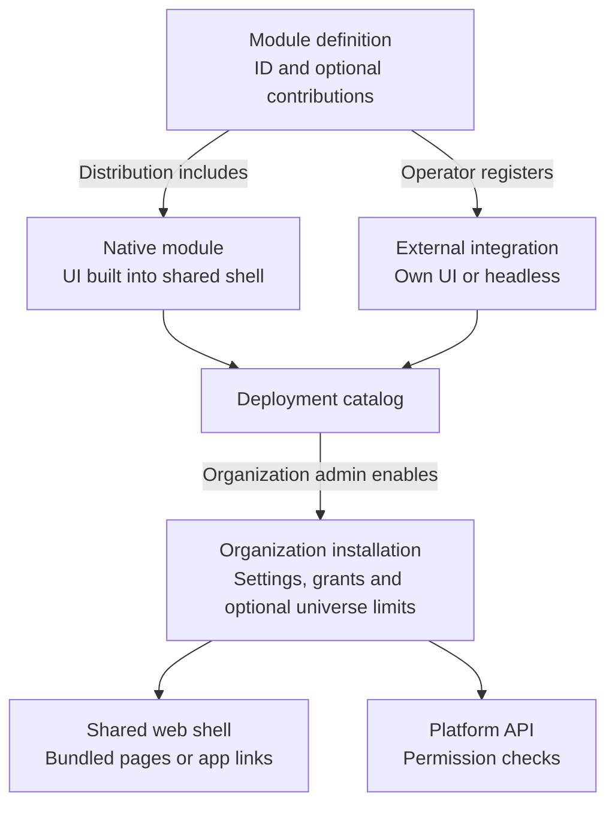
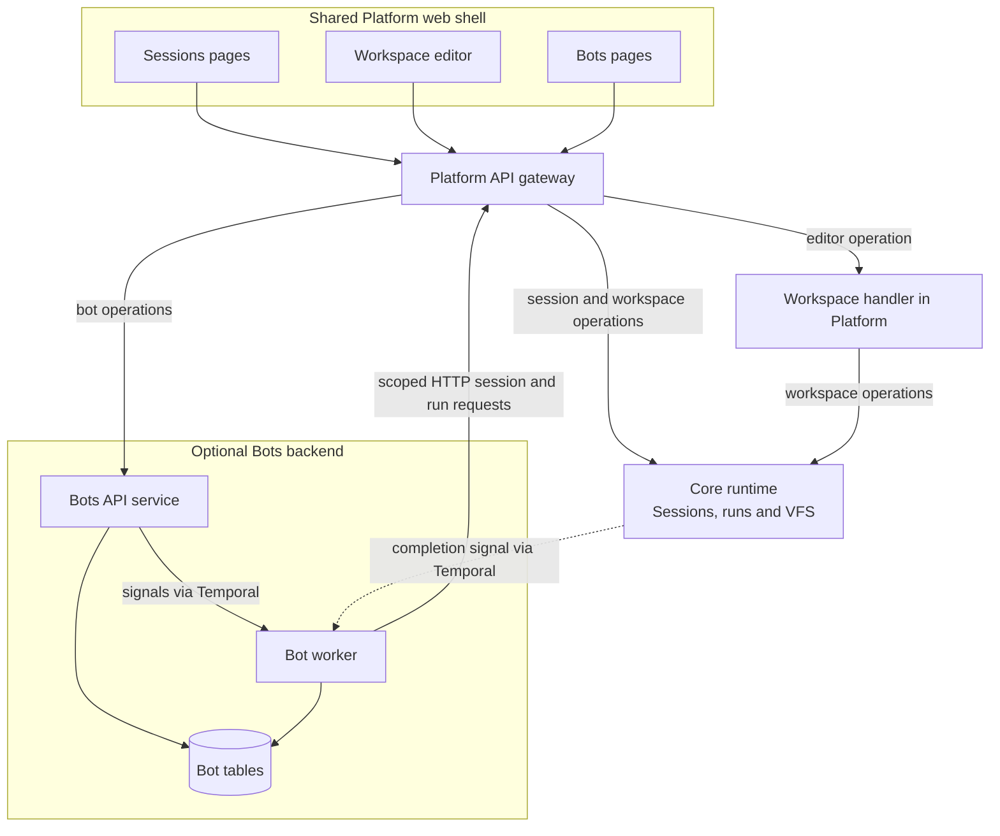
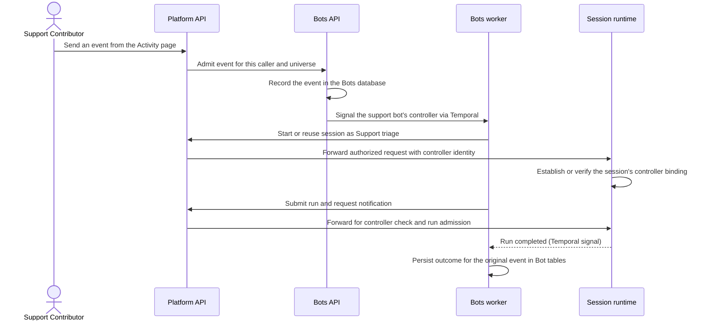
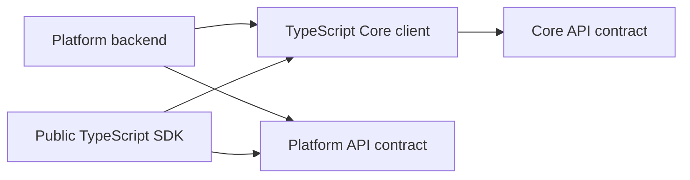

# Platform modules on a shared Lightspeed deployment

**Status** — Proposed for review.

Lightspeed teams contribute product features as **modules**. The Sessions module adds pages for sessions the Rust runtime already manages. The Bots module owns the whole feature, from its pages and API to its worker and database tables. They use the same plugin system. Platform defines how modules register pages and operations, and each distribution selects the modules it includes.

An organization can enable the modules it needs on a shared deployment. Its universes remain the boundaries for sessions, credentials, and other resources.

## How teams contribute and ship

| Contribution | What the user sees | How an update ships |
| --- | --- | --- |
| **Native Platform module** | Pages, settings, or actions integrated into the shared shell. | When one team updates its UI package, CI tests it with the shell. That change can ship on its own in the next shared frontend deployment. |
| **External integration** | A link to a separately hosted application, or a headless service that uses the Platform APIs. | The integration team deploys its own UI and services on its own schedule. It calls Lightspeed with scoped credentials. |

The distribution selects native UI packages at build time. At run time, configuration can activate a bundled page or supply something the shell already knows how to render, such as a navigation link. A team that needs a new React component inside the shell contributes it to a native package. Its backend can still ship independently as long as its API stays compatible. Independently loaded transcript extensions would be a separate design. These choices apply equally to open-source, proprietary, and client-built features.

## How a module becomes available to a team

The deployment operator decides which modules to offer each organization. An Organization Admin enables a module once. If it provides features in universes, all current and future universes in the organization inherit that choice by default. The admin can limit it to selected universes when needed. A module that works entirely at organization scope can contribute an organization page directly.



## What stays in core

The **Core runtime** owns sessions, runs, durable state, and tool execution. It should build and run with the entire `modules/` directory omitted. Modules are clients of its published API, event stream, and workflow protocols. Core can bind a session to a controller and notify it when a run finishes without knowing which product feature implements that controller. Core also enforces deployment limits on capabilities such as VFS and web search. A universe or session can narrow those limits further. [Session and workflow contracts](../../documentation/integrating-and-extending/workflow-tools.md)

**Platform** owns identity, organizations, universes, permissions, module availability, and the shared shell and gateway. Browsers, CLI clients, and module services normally send HTTP requests through the gateway. Module services use credentials scoped to the installation and universe. A trusted worker participating in an admitted workflow can exchange protocol signals directly over Temporal. The operator decides separately which UI packages to bundle and which workers may access Temporal. [Workflow transport and trust](../../documentation/integrating-and-extending/workflow-tools.md#preserve-integration-and-delivery-semantics)

## How Sessions, Workspaces, and Bots use the same module system

| Module | What the module owns | How a request runs |
| --- | --- | --- |
| **Sessions** | Session list, transcript, and run controls. | The pages use the existing session API through Platform. Other clients can still start sessions when the distribution omits these pages. |
| **Workspaces** | The file browser and editor for VFS. It can also contribute a handler to the Platform backend if an editor action needs server-side logic. | Platform authorizes the request. The handler can compose Core workspace operations, and Core owns the snapshots and blobs. |
| **Bots** | Bot pages, public operations, records and migrations, and a Temporal worker for controllers and triggers. | Platform forwards authorized bot operations to the Bots API. The worker calls Core through the gateway and receives workflow notifications over Temporal. |



An organization can disable the Workspaces module while its agents still use VFS. To disable VFS execution for a deployment, the operator sets a Core capability limit. Enabling Bots for a second organization lets its authorized members use the Bots service and worker already running in the deployment.

## A concrete example with Bots

Suppose Acme enables Bots for its support universe. A Contributor opens **Bots → Support triage → Activity** and sends the bot an event. The page, the public bot operations, and the process that does the work all belong to the Bots team. They ship in different places.

The **Bots UI package** contributes the `/u/:handle/bots` routes and their navigation entry. Sending an event is a domain operation, so the Activity page, CLI, and SDK use the same supported `bots/events/admit` API. A UI-specific endpoint may assemble the activity history and session summaries for that page using the caller's permissions on each resource. The **Bots worker** runs the controller and trigger workflows. An Activity page change ships with the shell. A compatible trigger fix can ship with the worker alone.

Bots owns its records, triggers, events, and database migrations. It could use a separate database or a schema in the shared PostgreSQL instance, where the module's database role determines which tables it can access. A deployment that omits the entire module should still be able to run sessions and collect unused blobs. Today, core session access queries and blob collection both reference bot tables. Their replacements must preserve session visibility and retain blobs that bot events still use. [Session access](../../../crates/store-pg/src/access.rs) · [Blob collection](../../../crates/store-pg/src/cas_sweep.rs)

When the Contributor sends an event, the gateway checks that Bots is enabled in the support universe, that the caller has `invokeBot`, and that their API key permits the operation. The worker then acts under two scopes of authority. [Bot permissions](../../../platform/backend/src/routes/method-actions.ts)

- **Installation.** The worker authenticates as Acme's Bots service. The gateway checks the target universe and the installation's grants on each HTTP request.
- **Controller.** Support triage starts a managed session. Core binds the session to its authenticated controller and checks that binding on later control requests. Release Assistant, another bot in the same installation and universe, may be allowed to read the conversation but cannot control it. Today's worker supplies controller identity in-process. The new boundary must preserve that authority across an authenticated call. [Bot worker](../../../crates/temporal-runtime/src/worker/bots.rs) · [Controller authority](../../../crates/temporal-runtime/src/gateway/service/controller.rs)



### What the Bots example must demonstrate

Before committing to a TypeScript rewrite, exercise one event end to end using only published contracts. Restart the worker after Core accepts the run but before Bots records that acceptance. On retry, the worker must recover the same session and run, and record the outcome once even if the completion notification arrives twice. Then have Release Assistant try to control that session using its own controller identity. Core must refuse the request even though the installation grant covers both bots.

## Shared design and product language

Use a shared session view for the transcript, composer, and session attribution. Bots already embeds `SessionDetail` from the Sessions page. Extracting that view lets both modules use it independently. For “Started by Support triage,” the view owns the wording, translations, placement, and fallback. Bots supplies the display name and, when the caller may open the bot, a link. If Bots is disabled later, the session still shows its recorded attribution as plain text. [Bot chat](../../../platform/web/src/components/bot/chat.tsx)

The broader question remains open. When a module introduces a new visual pattern or term, what would justify moving it into the shared design system? For general-purpose UI slots or transcript renderers, identify a concrete feature that needs an extension point before defining its interface.

## How configuration could read

These YAML excerpts illustrate three decisions. The field names are proposals for discussion.

**1. The publisher describes what the module contributes.** This excerpt declares the actions Platform checks before forwarding two bot operations. Under the current role mapping, a Contributor can send an event, while editing a trigger requires Operator or Owner.

```yaml
id: bots
operations:
  bots/events/admit: { action: invokeBot }
  bots/triggers/put: { action: manageBot }
```

**2. The distribution selects native modules. The deployment operator makes services available.** The distribution's list selects the web and API contributions for the shared application. Sessions contributes pages alone. Bots also contributes operations, so the operator supplies its service endpoint. Acme's approvals link opens the client's own UI.

```yaml
distribution:
  nativeModules: [sessions, workspaces, bots]
deployment:
  modules:
    bots:
      service: http://bots.internal
    acme.approvals:
      appUrl: https://approvals.acme.example
      organizations: [acme]
```

**3. Acme's admin enables modules for the organization.** Approvals is available across Acme. The admin limits Bots to the support universe, where the team can configure individual bots, triggers, and credentials. A newly created research universe inherits Approvals automatically.

```yaml
kind: organization
handle: acme
modules:
  acme.approvals: { enabled: true }
  bots: { enabled: true, universes: [support] }
```

The organization installation governs who can use Bots and in which universes. It also gives the operator a scope for lifecycle decisions.

- **Access.** Removing a universe from the installation closes access to the module there. Today, turning off Bots in a universe gates member requests while scheduled work can continue. Existing universe choices should carry over.
- **Suspension.** Define what happens to the next trigger, queued events, and a run already in progress. Today's per-bot **Pause** stops schedule and poll production and pauses delivery while an active run continues. Installation-wide suspension needs an explicit policy for each of those cases.
- **Deletion.** Define when Bots removes its triggers, events, and records, and how Core's session retention policy applies to conversations that outlive the bot. [Current Bots lifecycle](../../documentation/using-lightspeed/bots-and-triggers.md#pause-update-reset-or-close)

## Proposed project structure

Lightspeed stays in one repository. `core/` builds the Rust `lightspeed-runtime` executable, `platform/` contains the reusable hosts, and `modules/` keeps each feature's code together. `distributions/standard/` assembles the shared deployment used by many organizations. A compatible module service or worker can ship independently.

```text
core/
  Cargo.toml                 Rust workspace for Core
  Cargo.lock
  crates/
    api/                     Public Core API contract
    …                        Session engine, workflows, storage, runtime adapters

platform/
  web/                       Shared shell, router, and navigation registration
  session-ui/                Shared session view used by Sessions and Bots
  backend/                   Authentication, permissions, gateway, and route registration
  db/                        Platform-owned records and migrations
  shared/                    Platform API contract and module registration types

modules/
  sessions/
    web/                     Session list, transcript, and run controls
  workspaces/
    web/                     VFS browser and editor
    api/                     Editor-specific handlers hosted in Platform, if needed
  bots/
    module.yaml              Module ID, operations, and required actions
    web/                     Bot pages, settings, and navigation
    api/                     Independently deployable Bots API service
    worker/                  Temporal workflows and activities
    db/                      Bot tables and migrations

distributions/
  standard/
    modules.yaml             Native modules included in the shared distribution
    web.ts                   Supplies selected page and navigation exports to the shell
    api.ts                   Wires selected operations to handlers or service routes

clients/
  cli/                       Lightspeed command-line client
  python/                    Public Python SDK
  typescript/
    core-client/             Typed calls to the Core API
    sdk/                     Public @lightspeed-ai/sdk package

environments/                Environment daemon and standalone providers
```

### Where modules are registered

Only the distribution's assembly code depends on both the hosts and the concrete modules. Module authors depend on the registration interfaces in `platform/shared/`. The shell and gateway accept contributions through those interfaces.

- **Frontend.** `distributions/standard/web.ts` supplies the selected UI contributions, such as the pages exported by `modules/bots/web/`. The shell builds its router and navigation from these exports. At sign-in or when switching organizations, it shows entries according to the organization's installations and the caller's permissions.
- **API.** `distributions/standard/api.ts` supplies the selected operation descriptors and their handlers or service routes. At startup, the gateway mounts the public operations under `/api/v1`. An editor operation can run in a Platform-hosted handler, while a bot operation goes to the configured Bots service. The gateway checks installation, scope, and permissions before dispatching module operations. The Sessions pages use existing Core routes through the gateway and need no API registration of their own.

The web and API entries for a feature share its module ID. The deployment starts the Bots worker separately. Temporal workflows, task queues, and database migrations belong to Bots and run under its deployment lifecycle.

The TypeScript Core client lives under `clients/` because both Platform and the public SDK use it. Core owns the session and run contract. Platform owns the contract for operations such as managing organizations. The arrows show build dependencies, including contracts used to generate bindings.



Application developers install `@lightspeed-ai/sdk` and point it at Platform. Module workers can use bindings for their own language with the same gateway and their scoped credentials. The Platform backend uses the smaller Core client to forward authorized calls to its private runtime endpoint.

Core has its own build and CI job. A change to a Bots page runs checks for the module and shell and ships with the shared frontend. A worker-only fix can ship with the worker. A Core API change also triggers checks for the clients and modules that consume the affected contract.
