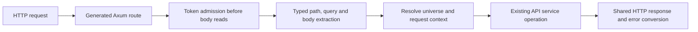
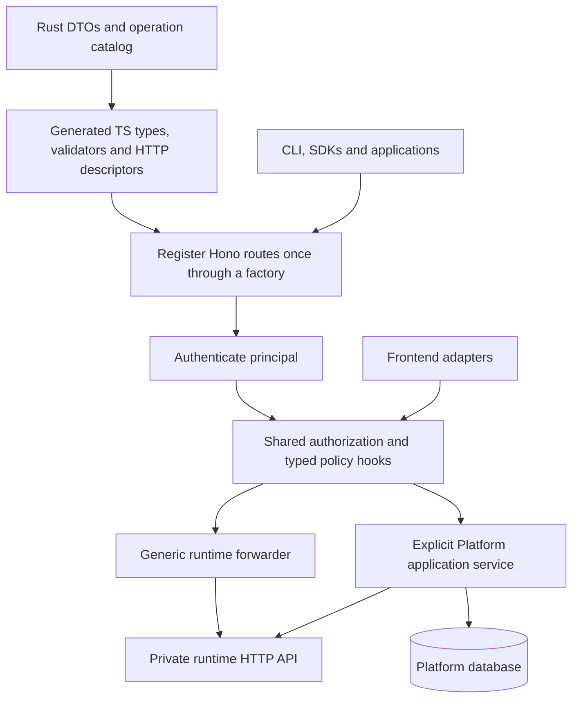

# P208b — A resource-oriented HTTP API

**Status:** Design for review, 2026-11-16. The move from JSON-RPC to a
resource-oriented HTTP client API is agreed. The implementation below is
proposed; no HTTP API migration has started.

This accompanies [runtime access simplification](p208-runtime-access-simplification.md)
and changes the transport assumed by
[Platform authentication and authorization](p209-platform-authentication-and-authorization.md).
That document's general-purpose RPC endpoint becomes the HTTP API described
here. Its principal, token and role design remains separate work.

## Decision

Expose one versioned resource-oriented HTTP contract through both the runtime
and the Platform. Use resources for reads and ordinary changes, and explicit
action endpoints for commands such as cancellation and compaction. Retain
typed operations internally and generate their HTTP bindings.

The Platform can authorize and proxy the runtime operations without declaring
their routes or DTOs again. It consumes a generated operation catalog and
registers those routes through one dispatcher. Platform-owned operations and
operations with Platform side effects have explicit handlers.

The result is:

- One authored declaration of each runtime operation, its HTTP binding and
  its request/response types, in Rust.
- One generated description used by the Rust router, Platform adapter,
  SDKs, CLI, documentation and contract checks.
- One Platform authorization implementation shared by the frontend adapter
  and the general API.
- One supported client transport after cutover. This is greenfield: remove
  `/rpc` and the JSON-RPC envelope rather than maintain two public APIs.

HTTP is already the runtime's transport. This change uses HTTP resources,
methods, statuses and media types in place of the JSON-RPC message envelope;
it does not change workflow orchestration or the deterministic harness.

## What exists today

There are 146 declared client operations: 129 universe, connection or service
operations and 17 deployment operations. The count is an inventory of this
checkout, not a target that future releases must preserve.

- [The API declarations](../../crates/api/src/rpc.rs) produce dispatch and
  metadata from `api_methods!`; deployment has a similar declaration in
  [deployment.rs](../../crates/api/src/deployment.rs).
- [Service interfaces](../../crates/api/src/service.rs) and DTOs are already
  independent of the HTTP server and the harness implementation.
- [The exporter](../../crates/api/src/schema_export.rs) generates JSON
  Schema, the method manifest, OpenRPC and the reference documentation.
- [The runtime HTTP adapter](../../crates/temporal-runtime/src/gateway/http.rs)
  already uses Axum, with authentication before reading an RPC body.
- [The Platform member client](../../platform/backend/src/runtime-client.ts)
  contains much of the existing authorization. Additional restrictions and
  Platform side effects remain in individual frontend routes.
- TypeScript and Python types are already generated from Rust schemas.
  Platform imports the TypeScript SDK's types instead of owning copies.

Preserve those foundations. A new collection of handwritten Axum routes plus
a second collection of handwritten Hono routes would discard their main
advantage.

## Addresses and ownership

Proposed path layout:

| Surface | Address | Contract owner |
| --- | --- | --- |
| Shared application API | `/api/v1/...` on either runtime or Platform | Runtime operation declarations; Platform applies its policy and lifecycle handling |
| Platform-only resources | `/api/v1/platform/...` on Platform | Platform: tokens, service accounts, membership and ownership operations |
| Frontend-specific adapters | `/api/ui/...` on Platform | Platform web application; may aggregate several operations |
| Browser sign-in and sessions | `/api/auth/...` on Platform | Existing authentication integration |
| Public runtime callbacks, metadata and webhooks | `/ingress/...` | Runtime integration endpoints; protocol behavior retained under the grouped paths |
| Environment routes | `/environments/...` | Machine connections and routing; protocol behavior retained under the shorter prefix |

The existing frontend routes occupy `/api/v1`. Move them to `/api/ui` and
update their web/demo consumers before mounting the shared API there. Do not
let router registration order decide which contract wins a collision.

The runtime keeps its three listeners. The private listener at default port
18080 serves `/api/v1`; the public callback/webhook listener stays on 18082;
the environment listener stays on 18083. Health and readiness remain on each.
The existing bind and configured-token settings retain their meaning during
this work; renaming environment variables is not a prerequisite.

### Public integration and environment prefixes

Group the runtime's public integration endpoints under `/ingress`:

| Purpose | Target path |
| --- | --- |
| OAuth callback | `/ingress/credentials/callback` |
| OAuth client metadata | `/ingress/credentials/client-metadata.json` |
| Bot webhook delivery | `/ingress/webhooks/bots/{universe}/{bot}/{trigger}/{token}` |

Use `/ingress` rather than `/callback`: this surface includes callbacks,
webhook deliveries and metadata reads. Individual endpoints keep their own
authentication through OAuth state, webhook tokens or signatures. These paths
are unversioned initially and remain independent of `/api/v1`.

Shorten the environment gateway's URL prefix to `/environments`:

| Purpose | Target path |
| --- | --- |
| Daemon registration | `/environments/connect` |
| Daemon data connection | `/environments/data` |
| Worker data route | `/environments/routes/{universe}/{environment}` |
| Replica stream coordination | `/environments/peer/streams` |
| Replica data connection | `/environments/peer/data` |

`/api/v1/universes/{universe}/environments/...` manages resources through the
application API. `/environments/...` carries machine traffic on its own
listener. Keep `environment-gateway` as the role/component name and retain
the existing environment-variable names and cryptographic domain identifiers.
The daemon discovery path remains `/.well-known/lightspeed-envd`.

Prefixes organize URLs; the separate listeners remain the network boundary.
A reverse proxy can route `/ingress/*` to the public runtime listener. For
externally registered daemons, expose the required environment connect/data
routes; worker routes and replica peer routes remain internal. Do not publish
the entire `/environments/*` namespace merely because connect/data are public.

Apply these path changes consistently to route constants, generated URLs,
OAuth redirect and client-metadata identifiers, webhook URLs, daemon/worker
clients, peer routing, deployment examples and documentation. Update configured
URLs and external OAuth registrations at cutover. This is greenfield: old
paths have no aliases or redirects. Message formats, signature rules and
credential ownership are unaffected by the namespace changes.

### Application resource addressing

The Platform serves its interfaces in the existing backend process, default
port 3000. A second backend process or internal HTTP hop is unnecessary.

Universe operations use `/api/v1/universes/{universe}/...`. The parameter
accepts a runtime universe UUID or handle. Platform resolves that reference
to its authorized universe record and forwards the canonical runtime UUID.
Its own database row ID is not another public spelling of the target.
Deployment operations, such as listing or creating universes, address the
collection rather than a universe-qualified child.

`GET /api/v1/connection` provides service discovery before universe selection:
server identity, runtime versus Platform, supported contract revision and
access information. It requires the appropriate authentication for that
server, just as today's authenticated `initialize` does.

The path is authoritative. The new shared HTTP API rejects a caller-supplied
`x-lightspeed-universe` header rather than accept two independent targets.
The runtime creates its existing universe request context from the path.
Platform constructs trusted actor attribution; direct runtime operators keep
the ability to supply an actor as described in P208.

## How the runtime serves HTTP

Keep Axum in `temporal-runtime`. Introduce an HTTP adapter module alongside
the existing gateway code; replace the private router's RPC mount at cutover.
The public and environment route sets receive the prefix changes above; they
do not become part of the generated application API or its Platform proxy.



The operation catalog supplies a consumer macro with each operation's typed
binding. One expansion produces schema/metadata registrations in `crates/api`;
another produces the Axum handlers and router registrations in the runtime.
This extends the existing `macro_rules!` approach rather than adding a new
procedural-macro framework. Axum types do not enter `crates/api`.
The Rust handlers are generated during macro expansion, not committed as a
second Rust source tree. The exported JSON contracts and generated client
artifacts remain committed and freshness-checked.

Generated handlers are adapters: extract input, call a typed assembler where
needed, select the service and invoke it, then encode the declared result.
Business behavior remains in the existing services. Authentication middleware
runs before any body-consuming extractor; JSON and binary input retain
explicit limits. Framework extraction failures use the same public error
format as service failures.

Declare three binding kinds: a JSON service call, an SSE adapter, or a binary
adapter. Today's real watch implementation lives in the HTTP gateway rather
than the default `AgentApiService::watch_universe` method; today's blob
methods return base64 JSON. These need deliberate adapter/service work, not
just new URLs. Stream handles remain runtime types; their event items and
metadata have public schemas.

Generate a closed HTTP response enum from each operation's declared variants.
The response adapter returns that enum, and a shared encoder implements its
status, headers and body. An existing `created` flag, for example, can select
the declared `200` or `201` variant. Do not allow an arbitrary `IntoResponse`
implementation to circumvent the declared status set. Custom response mapping
has conformance tests just as custom input assembly does.

Explicitly account for `HEAD` and `OPTIONS`. Axum's automatic `HEAD` support
for a `GET` route must not bypass admission or accidentally open an SSE
stream; the generated binding declares which operations support it. CORS and
preflight handling are transport behavior, not additional domain operations.

Where an existing service input combines a path identifier and a body, use
an explicit typed conversion. Never merge arbitrary JSON objects and allow a
body value to replace an identifier extracted from the path.

## One operation catalog

Move transport-neutral operation metadata out of the RPC-specific module and
extend it with the HTTP binding. An operation declares:

| Field | What it determines |
| --- | --- |
| Stable operation ID | SDK identity, policy lookup, logs and coverage; independent of URL spelling |
| Resource family and scope | Universe, deployment, connection or machine-only operation |
| HTTP method and path template | The actual router registration and documentation |
| Typed path, query and body inputs | Where every field comes from; explicit no-body and binary-body cases |
| Typed service binding | Service method and any conversion from HTTP inputs |
| Response variants | Allowed status codes, DTOs, content types and response headers |
| Error variants | Shared machine-readable kinds and their HTTP mapping |
| Access classification | Existing action, least role and API family, published for Platform |
| Resource targets | Explicit universe/session/run/transcription/etc. identifiers used by policy |
| Transfer and retry behavior | JSON, bytes or SSE; limits, submission identity and concurrency rules |
| Documentation | Summary and operational semantics, retained from today's manifest |

Resource targets must be explicit. Today's session-target inference from a
method-name prefix is insufficient for transcription ownership and other
resource checks. Neither the HTTP verb nor a URL prefix determines permission.

An illustrative declaration for reading a profile would contain the following
information. This is design notation, not an API already implemented:

```rust
operation! {
    id: profiles_read,
    family: profiles,
    scope: universe,
    http: GET "/api/v1/universes/{universe}/profiles/{profileId}",
    path: ProfileReadPath,
    query: NoQuery,
    body: NoBody,
    service: read_profile,
    input: ProfileReadInput::from_path,
    response: 200 => ProfileReadResponse,
    access: read,
    minimum_role: viewer,
    target: profile(path.profile_id),
}
```

Serde/Schemars DTOs are authored once in `crates/api`, including any new
HTTP-specific path/query/body types. Existing resource views are reused.
Separating a wire request into locations may require Rust binding types;
it does not require equivalent handwritten TypeScript or Python types.

The exporter validates unique IDs, route collisions, bound path parameters,
declared input locations and result variants. The generated Rust binding must
call an existing service with the declared input/output types; the compiler
checks that relationship. A custom Rust assembler is opaque to the exporter:
its field semantics require request-to-service conformance fixtures. Where
the catalog declares field assignments directly, generate exhaustive struct
literals so missing assignments fail compilation.

## Adding a resource

For a new runtime resource:

1. Add its record/service behavior in the appropriate domain and runtime
   components, following the existing boundaries.
2. Add its public DTOs and operation declarations in `crates/api`. Declare
   paths, input locations, response semantics and policy targets there.
3. Add service behavior and HTTP binding tests. Operations with a new policy
   need Platform policy tests as well.
4. Regenerate the Rust binding metadata, OpenAPI, TypeScript/Python consumers
   and reference documentation.
5. Review its Platform admission: proxy with an existing supported policy,
   an explicit Platform handler, or unavailable through Platform.

There is no step to copy its route, request interface, response interface or
schema into Platform. A new runtime operation is not automatically published
to untrusted callers just because it appeared in the generated catalog.

## Platform: authorize and proxy, without repeating the API



Platform imports generated descriptors containing the method, path, operation
ID, codecs, media types and policy metadata. A route factory registers them
with Hono. All eligible registrations enter one dispatcher; there is no
handwritten `app.get` or `app.post` for each runtime operation.

Conceptually:

```typescript
for (const operation of runtimeHttpOperations) {
  app.on(operation.method, operation.honoPath, context =>
    dispatchAuthorizedOperation(context, operation));
}
```

The path selects a known operation, never an arbitrary destination. Generated
Hono paths and Axum paths come from the same template with checked conversion.
An unrestricted wildcard reverse proxy is not the application gateway.

The dispatcher performs these steps:

1. Authenticate into a transport-independent principal context. Browser
   cookies and program tokens produce that context through their respective
   authentication adapters; browser requests retain CSRF/origin protection.
2. Check the operation's Platform disposition, coarse role and token-family
   restrictions. Missing or unsupported classification is refused.
3. Resolve the authorized universe. Decode bounded input with generated
   codecs/validators and run the relevant resource policy. Binary requests
   must pass their authorization before their bodies are forwarded.
4. Apply typed policy transformations, such as forced soft deletion or a
   visibility filter. They operate on generated types, not untyped bags of
   fields.
5. Call the generic forwarder or the explicit Platform application service.
6. Apply any required response policy before returning bytes, then encode
   the result or stream the authorized upstream response.

Move today's `MemberClient` policy and security-relevant route checks into
shared application policy functions. The frontend calls these functions too;
it does not have to make an HTTP request to its own public endpoint.

### What Platform must still author

Authorization cannot be generated from DTO schemas alone. Platform owns a
typed admission/policy registry keyed by generated operation IDs. Every
operation is accounted for as:

- **Proxy:** authorize, optionally transform a typed request, then forward.
- **Platform handler:** call an application service with Platform side effects.
- **Denied:** machine-only or not yet supported through Platform.

The registry reuses the manifest's role/family/target metadata. It does not
repeat HTTP paths, DTOs or their fields. Policy implementations can cover many
operations; exceptions are explicit. Coverage tests require a reviewed
disposition for every operation, with unknown operations denied. Adding a
resource normally adds a small policy/admission entry, not another API.

Session visibility, Contributor input restrictions, transcription ownership,
watch filtering and actor construction are examples of actual policy work.
For transcriptions, inspect a bounded result or do an authorized preflight
before releasing content. An authenticated but otherwise unexamined proxy
would expose the runtime's full authority.

### Operations that need a Platform handler

Universe creation is the clearest example: it must enforce creator/owner
rules and quotas, create runtime state, and establish Platform records and
membership. Listing universes must filter the inventory. Deletion and related
lifecycle operations must coordinate the Platform state as well.

These use the same generated request/response types and shared route binding,
but dispatch to an application service instead of pass-through forwarding.
The existing frontend services should be extracted and reused. Retry identity
and recovery after one database succeeds and the other fails are part of
those services. The proxy must not expose a second path around them.

Platform-only resources, such as service accounts and tokens, are declared
once by Platform under `/api/v1/platform`. Keep their TypeScript/Zod schema
ownership there and generate their types, validators and OpenAPI fragment.
Do not put Platform identity models into Rust merely to share a generator.

Those native resources have their own operation declarations: ID, method,
path, Zod inputs/results, policy and application-service binding. Export them
to the same normalized descriptor format as the runtime catalog, with a
separate schema bundle. Keep the declaration/export module independent of
backend startup and the generated SDK, avoiding a generator dependency cycle.
The client generator composes both artifacts, checks name/path collisions,
and generates runtime and Platform operation modules over one transport.
Native SDK routes and DTOs are generated too; a direct runtime connection
reports that Platform-only operations are unavailable. A lifecycle override
references the existing runtime operation rather than declaring its route
again. Discovery's Platform variant follows this same native export path.

The Platform OpenAPI document combines the admitted runtime operations with
those native operations. It reuses runtime schema components and omits
machine-only routes. Shared operations retain the same response contract;
Platform-specific ownership views belong to its native contract. Connection
discovery has a common shape with an explicit runtime/Platform discriminator
and typed access information, rather than two incompatible `initialize`
responses hidden behind the same client method.
The runtime owns its discovery variant; Platform supplies its principal/access
variant. The composed SDK generates the discriminated union without adding
Platform identity records to the Rust runtime contract.

### Forwarding rules

- Build the upstream URL from the fixed configured runtime origin, the
  generated template and validated/encoded identifiers. Disable redirects.
- Replace authorization and actor headers from trusted context. Do not
  forward client cookies, host/forwarding headers or arbitrary
  `x-lightspeed-*` headers. Universe selection comes from the canonical path.
- Allowlist the headers needed by the operation's media type and supported
  conditional/range behavior. Never return upstream cookies.
- Prefer relative resource links. Rewrite permitted `Location`,
  `Content-Location` and `Link` targets to the public API where necessary;
  never direct a public client to a private runtime origin.
- Bounded JSON may be decoded and rewritten for policy. Remove stale length,
  encoding and validator headers after a transformation.
- Request identity encoding upstream and define behavior for unexpected
  encoded responses. Node Fetch may decompress a response implicitly, so
  even a pass-through body cannot blindly retain upstream encoding/length
  headers. The adapter must ensure headers describe the bytes it forwards;
  range/validator support also requires verified representation semantics.
- Proxy SSE and binary data with backpressure and abort propagation; do not
  collect a transfer into a JSON object or an in-memory buffer.
- Complete authorization before sending success headers or response bytes.
  Once streaming starts, a later failure has stream-specific handling.
- A lost client connection aborts transport work. It does not implicitly
  cancel a durably admitted run; cancellation remains an explicit operation.

## Libraries and generation

| Concern | Planned choice | Reason |
| --- | --- | --- |
| Rust HTTP server | Existing Axum `0.8`, Tokio `1`, `http` `1`, Tower-compatible middleware | Already serves the runtime; typed extraction, routing, response bodies and SSE |
| Runtime DTOs | Existing Serde `1` and Schemars `1` | One source for wire types, validation shape and documentation |
| HTTP/OpenAPI export | Extend the existing `serde_json` exporter and declaration macros | Keeps route, service binding and policy metadata together |
| Platform server | Existing Hono `4` and `@hono/node-server` | Generated registrations and shared dispatch in the current process |
| Platform proxy transport | Node's existing Fetch/Web Streams APIs, with explicit header and cancellation handling | Supports bounded JSON and streaming bodies without a separate proxy service |
| Shared request validation in Platform | Add Ajv `8` and formats support; generate standalone validators at build time | Validates generated runtime schemas without handwritten Zod copies |
| Platform-owned schemas | Existing Zod `4` and its JSON Schema export | Keeps identity/access resources with their owning subsystem |
| TypeScript SDK | Existing `json-schema-to-typescript` plus the repository's generator and Fetch transport | Reuses resource types; adds generated HTTP parameter codecs and operation helpers |
| Python SDK | Existing `datamodel-code-generator` and `httpx` | Same ownership model and streaming support; replace RPC transport generation |
| OpenAPI validation | Add a locked development dependency on Redocly CLI | Lint and resolve the generated runtime and composed Platform descriptions |

Exact added package versions will be selected and locked during implementation;
existing concise Rust dependency ranges stay concise. No new HTTP server,
external API gateway, or new authentication library is needed for this change.

Do not add Utoipa or Aide alongside a separately maintained operation catalog.
They are alternatives if a prototype demonstrates that one can replace the
generation plumbing without introducing a second set of route/type/policy
annotations. The initial plan keeps the current Schemars-based foundation.

Use OpenAPI 3.1 for the first contract. Generate its schema dialect explicitly
with Schemars' JSON Schema 2020-12 settings and normalize references into
`components/schemas`. The current draft-07 bundle cannot simply be pasted
into it. Existing SDK schema generators may continue consuming a draft-07
export from the same Rust types until their 2020-12 behavior is verified;
these are generated views, not separately authored contracts.

The normalized operation manifest is the SDK/proxy generator input. OpenAPI
is a public artifact produced from that same catalog, not another source of
hand-maintained mappings. Cross-artifact tests enforce agreement. Describe
SSE media types and event schemas explicitly; OpenAPI alone does not generate
reconnection, cancellation or authorization behavior.

Export JSON Schemas and standalone validators in an explicit SDK/server
subpath so the browser client does not acquire a server validator dependency.
Platform consumes checked-in/generated artifacts at build time; it does not
download route definitions from whichever runtime happens to answer a request.
Connection discovery reports a contract revision, and Platform refuses to
proxy an unsupported revision. Unknown routes never become public through
runtime discovery.

## HTTP behavior to preserve and define

### Resource shapes

Use plural resource collections. Examples below omit
`/api/v1/universes/{universe}`:

| Existing operation | Intended binding style |
| --- | --- |
| `session/list`, `session/read` | `GET /sessions`, `GET /sessions/{sessionId}` |
| `session/start` | `POST /sessions` |
| `session/config/put` | `PUT /sessions/{sessionId}/config` |
| `session/runs/start` | `POST /sessions/{sessionId}/runs` |
| Run cancellation and steering | Explicit `POST` actions under the run |
| Context compaction | `POST /sessions/{sessionId}/context/compact` |
| Profile/model/credential management | Resource collections with explicit actions where lifecycle requires them |
| `universe/watch` | `GET /events`, `Accept: text/event-stream` |
| Blob transfer | Binary upload/download bindings, with a declared identifier encoding |

Before implementation, the operation inventory assigns every current method
a concrete binding or an explicit removal. Do not derive all routes by
replacing slashes in RPC names. Review batch operations, credentials leasing,
workspace paths, deployment operations and asynchronous commands individually.

Path identifiers have defined encoding rules. Arbitrary VFS paths and
structured blob references need typed query fields or a canonical opaque
identifier; they must not become ambiguous catchall paths. Query codecs define
repeated arrays, booleans, numbers and omitted values. Reject unknown fields,
duplicate scalar parameters, conflicting identifiers and ambiguous encodings.
Rust and TypeScript use the same conformance fixtures.

Generated schemas validate shape; they do not capture every handwritten
domain invariant. Existing service validation, including transcription input
validation, remains authoritative. Platform adds authorization rather than
reimplementing those domain validators. Its Ajv validators use strict input
checks, without silent coercion, default insertion or removal of extra fields.
The prototype must cover the existing integer formats (`int32`, `int64`,
`uint32`, `uint64`), defaults and unknown-field behavior against Serde. Define
numeric-format validators or exported constraints explicitly instead of
ignoring unsupported formats. Values requiring the full 64-bit integer range
need a lossless wire representation, such as decimal strings; bounded JSON
numbers must remain exact in JavaScript. No policy decision may rely on a
silently rounded identifier or counter.

### Responses and errors

Return the declared response DTO directly, without JSON-RPC request IDs or
the outer JSON-RPC result/error envelope. Resource DTOs may still have useful
named fields and pagination metadata; this is not a demand to flatten every
response. Audit `AgentApiOutcome` and inline notifications explicitly before
removing the old envelope, so no notification behavior disappears accidentally.

Use `application/problem+json` with the RFC 9457 fields and stable domain
extensions such as `kind`, field errors and submission identity. Map domain
errors centrally, distinguishing malformed input, authentication, authorization,
absence, conflict, deletion and transient unavailability. `413` means the
request is too large; it must not be used for today's `ResponseTooLarge` error.
Keep internal exception details out of public failures. Tests must cover the
status and structured body together, including framework extraction failures.

`201` means a resource was created. `202` is available only when durable
admission is established; an uncertain wait timeout is not proof of admission.
Review each `operationPending` path before mapping it. Poll existing run/job
resources where possible. Do not promise a generic `/operations` resource or
emit a `Location` that cannot actually be read.

Keep existing submission IDs, deduplication rules and configuration revisions.
The migration does not make every `POST` retryable. Publish which operations
support retries, how identity is supplied, what happens for a changed payload
under the same identity, and how long deduplication lasts. Do not introduce
generic idempotency keys or ETag/If-Match semantics without implementing their
durable meaning.

### Streams and bytes

Keep the universe watch's batching, reset and refetch behavior. It is not a
durable event log, and `Last-Event-ID` must not imply replay that does not
exist. Preserve Platform's bounded watch lifetime and reauthorization on
reconnection while the broader token-revocation design is settled. Stream
errors and terminal events need their own declared schema.

Add a binary path through the storage service as well as the HTTP adapter.
Wrapping base64 internally while claiming to stream externally would retain
the memory cost. Preserve universe ownership checks, content addressing,
deduplication and size budgets. Map the existing batch-upload capability
explicitly rather than silently dropping it. Range requests and conditional
downloads are separate capabilities to implement and test before advertising.
Authenticated JSON and event responses default to no-store; immutable content
does not imply permission to cache it publicly.

## Implementation order

1. **Binding inventory and contract prototype.** Record all 146 current
   operations and their replacements/removals. Prove one read, one command,
   one error, an SSE stream and a binary transfer through the proposed
   generator. Validate the OpenAPI dialect and SDK generator compatibility.
2. **Runtime HTTP adapter.** Generate typed Axum bindings, authentication
   admission, parameter codecs, request context and response/error conversion.
   Mount on the existing private listener. Apply the agreed `/ingress` and
   `/environments` paths across their existing listeners and all callers;
   preserve the listener separation and protocol behavior.
3. **Clients and frontend adapter relocation.** Generate the CLI and both
   SDK transports, update Configurator tool bindings, move frontend routes
   and consumers to `/api/ui`, and update development configuration/docs.
4. **Platform adapter foundation.** Generate registrations, validators and
   the common dispatcher; extract existing member policies and Platform
   lifecycle services. Prove proxy and native-handler paths with the existing
   browser principal. No unrestricted public proxy is enabled as a shortcut.
5. **Platform authentication integration.** P209 supplies personal/service
   tokens, ownership and the remaining principal policies. Compose and publish
   the admitted shared API plus the Platform-owned contract. Those features
   are not implied by finishing the HTTP transport.
6. **Cutover and removal.** Regenerate all artifacts and documentation;
   remove JSON-RPC client transport, `/rpc`, OpenRPC and obsolete adapters.
   Update release packaging and manifest verification, which currently name
   the old contract files explicitly, to include the new contract artifacts.
   Temporary branch-local coexistence during implementation is acceptable;
   the released client API has one transport.

The completion boundary for the transport work is the runtime, its consumers,
and a tested Platform adapter foundation. The public Platform token gateway
is complete only when P209's authorization work is complete. Neither milestone
should be reported as the other.

## Validation

- Every old operation has a reviewed replacement or removal; every new
  operation is mounted, documented and generated into clients.
- Catalog and schema checks reject conflicting paths, missing bindings,
  unclassified exposure and incompatible request/response variants.
- Runtime and Platform request codecs agree on paths, queries, malformed
  encodings, duplicate fields, optional values and strict unknown-field rules.
- Authentication refuses requests before consuming large or unending bodies.
- The grouped ingress URLs generate matching OAuth redirects, client metadata
  and webhook addresses. Daemon registration, data routing and peer relays use
  the shortened environment paths. Old paths are absent, and each listener
  continues to exclude the other listeners' route families.
- The same shared API fixtures work directly and through Platform, with
  differences limited to documented authorization and Platform side effects.
- Unknown and machine-only operations are refused through Platform. A new
  runtime route cannot bypass the reviewed admission registry.
- Browser and program adapters share role/visibility/transcription policy;
  forged actor/target headers do not change the authenticated target.
- Universe lifecycle tests verify native overrides, retry behavior and partial
  failure recovery instead of an accidental pass-through route.
- Real HTTP tests cover ordinary responses, structured errors, async retries,
  SSE reset/reconnect, large binary transfer, cancellation and backpressure.
- Generated contracts, CLI, TypeScript/Python SDKs, Platform and Configurator
  pass their gates. Run the exact workspace/all-target Clippy command for the
  implementation, with warnings denied.

## Outside this change

The harness, Temporal workflow protocol and MCP transport stay as they are.
Environment message semantics and credentials, OAuth flows and webhook
authentication stay as they are; their runtime HTTP paths change as specified
above. Channel removal remains separate. This design does not decide token
lifetimes, Creator entitlements or the remaining P209 policy questions.

## References

- [Axum routing](https://docs.rs/axum/0.8/axum/struct.Router.html) and
  [middleware](https://docs.rs/axum/0.8/axum/middleware/index.html).
- [Schemars schema settings](https://docs.rs/schemars/1/schemars/generate/struct.SchemaSettings.html).
- [OpenAPI 3.1.1](https://spec.openapis.org/oas/v3.1.1.html).
- [Hono proxy helper](https://hono.dev/docs/helpers/proxy), for comparison with
  the explicit fixed-upstream forwarder; the helper does not supply policy.
- [Ajv standalone validation](https://ajv.js.org/standalone.html).
- [Redocly CLI lint](https://redocly.com/docs/cli/commands/lint).
- [HTTP semantics, RFC 9110](https://www.rfc-editor.org/rfc/rfc9110.html) and
  [problem details, RFC 9457](https://www.rfc-editor.org/rfc/rfc9457.html).

## Progress

- 2026-11-16: companion design written before implementation, following the
  decision to replace the shared JSON-RPC client transport. No API code or
  generated contract changed. The broad Rust validation left over from P208
  remains interrupted after the requested removal of `target/`; this design
  does not mark that validation complete.

- 2026-11-16: added the agreed `/ingress` grouping and `/environments` prefix,
  including caller/configuration cutover and route-isolation checks. Retained
  `/ingress` as the broader name covering callbacks, metadata and webhooks.
  These are design changes; the runtime paths have not yet been migrated.
